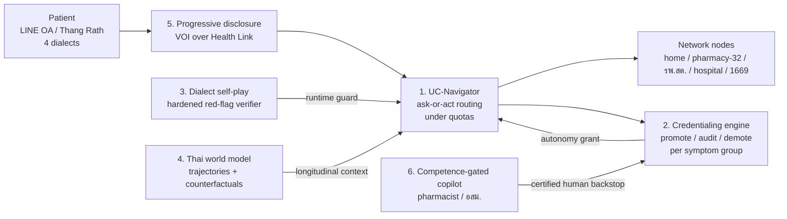

# Thailand's Care Network Rewrites McKinsey's AI Playbook

In October 2026 all three of McKinsey's vectors hit the same wall. The models are capable in isolation. What is missing is the machinery that turns that capability into action people can trust: knowing when to ask a question and when to act, knowing which patients a trajectory model is calibrated for, and knowing what evidence earns an AI the right to act alone.

The evidence for each vector is uneven. Discursive AI has reached real patients: Google's AMIE completed a supervised prospective study, and a Chinese RCT with 2,069 patients cut consultation time by 28.7%. Yet no study shows that autonomous dialogue AI improves outcomes, and lay people who used LLMs did *worse* than controls. Trajectory foundation models forecast more than 1,000 diseases, but they only predict what happens under usual care, they miscalibrate for subgroups, and none has been validated in a low- or middle-income country. Autonomous AI exists only as narrow tuples of task, population and operating point (diabetic-retinopathy screening, normal chest X-rays, Utah's prescription renewals), and nobody has written a statistical rule for granting or revoking that autonomy.

Thailand changes the problem. NHSO is already the "payer orchestrator" that McKinsey predicts for the US. It has a national data exchange, a funded front door staffed by non-physicians (pharmacies treating 32 symptom groups, 10,910 รพ.สต. equipped for telemedicine, about 1.07M อสม.) and a budget line that already buys Thai AI per hospital. What it lacks is a validated conversational layer, a trajectory model and an autonomy protocol. The most ambitious capstones exploit that asymmetry. Ranked, they are:

1. a routing agent that knows UC capacity and entitlements, trained in a simulator of the whole UC network;
2. an "AI residency as code" engine that grants and revokes autonomy per symptom group while certifying the human backstop;
3. dialect-adversarial self-play aimed at verifier blindness rather than reward hacking;
4. a Thai patient world model;
5. a progressive-disclosure agent over Health Link;
6. a copilot that builds the skills of non-physician staff.

The top three fit together into one system and extend the student's audit-first plan. Direction 4 has the highest ceiling but depends on data access. McKinsey's frame is useful but shaped by the US. Its economics assume fee-for-service. Its claim that data, not model capability, is the bottleneck is contradicted by 2026 evidence on escalation. And its billing-code "signal of scale" has a Thai equivalent that Thailand has already reached.

## Discursive AI reached real patients in 2026 but has not yet improved a single outcome

The 2026 evidence ladder for AI-first encounters has five rungs: simulated OSCEs, then retrospective concordance, then supervised prospective feasibility, then RCTs with process outcomes, then RCTs with clinical outcomes. Nobody has reached the top rung with a positive result.

The highest rung with a positive result is Google's AMIE study at an urgent primary-care clinic (BIDMC). About 100 patients chatted with AMIE before their visit, under real-time human supervisors. AMIE's differential contained the final diagnosis in **90% of cases (top-3: 75%)**. Its blinded differential quality matched primary-care physicians, and **no consultation needed a safety stop**. But physicians beat AMIE on how *practical* its management plans were (**p=0.003**) and on cost-effectiveness (**p=0.004**) ([arXiv 2603.08448](https://arxiv.org/abs/2603.08448)).

The strongest randomised process evidence comes from China. PreA, a GPT-4o-mini agent with no clinical fine-tuning, was co-designed with local stakeholders. In a 2,069-patient RCT it cut specialist consult time by **28.7%**, and the AI-only arm matched the AI-plus-staff arm ([Nature Medicine](https://www.nature.com/articles/s41591-025-04176-7)).

The outcome rung is null so far. In the Penda Health/OpenAI cluster RCT (16 Kenyan clinics, nearly 10,000 encounters), treatment failure fell **23%, which was not significant**, at about US$0.04 per patient. A co-author estimated that **~139,000 patients** would be needed to detect a meaningful outcome difference ([Nature Medicine](https://www.nature.com/articles/s41591-026-04503-6); [NPR](https://www.npr.org/2026/07/23/g-s1-134929/ai-artificial-intelligence-healthcare)).

The most important finding of the year concerns the human in the loop. In Oxford's preregistered study, LLMs alone identified a relevant condition in **94.7–99.2%** of scenarios. Lay people using those same LLMs managed only **≤34.5%**, worse than controls who searched on their own (47%) ([arXiv 2504.18919](https://arxiv.org/pdf/2504.18919)).

Read together, these studies locate the frontier's weakness in two places: the interaction (what patients say and leave out) and management that fits the local context (what is practical and affordable here). They do not locate it in medical knowledge.

Benchmarks released in 2026 show *how* the interaction fails. It fails as a sequential decision, not as a gap in knowledge.

- CARE-Bench scores triage turn by turn. When the correct move was to ask a clarifying question, **only 33.5%** of prompted outputs asked one. Models recommended care before they had gathered what they needed ([arXiv 2608.03731](https://arxiv.org/abs/2608.03731)).
- An October 2026 escalation audit tested open models from 1.7B to 9.7B parameters. Models prompted to consider uncertainty **missed 32–97% of required escalations**. Verbalised confidence had an expected calibration error (ECE) of 0.10–0.54.
- The same audit has the result most relevant to this capstone. Rule-based red-flag detectors fell from **recall 1.00 on trigger phrases to 0.00 on unseen paraphrases** ([arXiv 2610.21270](https://arxiv.org/html/2610.21270)).
- MAI-DxO's headline (**80–85.5%** on NEJM cases against 20% for generalists) is self-reported. Its costs are simulated, and its physicians were barred from references and colleagues ([Microsoft Research](https://www.microsoft.com/en-us/research/publication/sequential-diagnosis-with-language-models/)).

Regulation reflects the same caution. Only one jurisdiction lets AI make a clinical decision without a physician: Utah's sandbox, which lets Doctronic *renew* existing prescriptions for chronic conditions ([Utah OAIP](https://commerce.utah.gov/ai/regulatory-relief-4/authorized-pilots/doctronic/)). Several other US states moved the other way and barred AI from presenting itself as a clinician. The 2026 CPT AI codes cover only measurement and imaging, with **no code for an AI-performed triage or E&M encounter** ([AMA](https://www.ama-assn.org/practice-management/cpt/cpt-codes-offer-language-report-ai-enabled-health-services)).

Thailand has the rails for discursive care but no validated layer running on them:

- **Pharmacies.** About **6,000 pharmacies** treat **32 symptom groups** free for gold-card holders, with about **8M consultations over two years** (a ministerial claim, May 2025) ([Thansettakij](https://www.thansettakij.com/health-wellness/health/627965)).
- **รพ.สต.** All **10,910 รพ.สต.** have telemedicine, with **1,531,456 sessions** logged ([Hfocus](https://www.hfocus.org/content/2026/02/37141)).
- **Quotas.** Demand outran budget badly enough that NHSO moved innovation units to **weekly quotas in July 2026** ([Hfocus](https://www.hfocus.org/content/2026/07/38840)).
- **Existing triage AI.** The country's open triage model, ThaiLLM-27B-Prescreen, has **F1 = 0 for "Observe at Home"**. It never sends anyone home ([model card](https://huggingface.co/ThaiLLM/ThaiLLM-27B-Prescreen)).

The headroom is real. A single-centre study at Warin Chamrap Hospital used voice-enabled GPT-4o for ED triage. It agreed with a physician panel at weighted κ **0.915, against 0.607 for triage nurses** ([Thai J Emerg Med](https://he02.tci-thaijo.org/index.php/TJEM/article/view/277102)).

## Trajectory models forecast a thousand diseases but prescribe nothing

Vector 2 has split into two camps.

The first camp builds small "natural-history" models.

- **Delphi-2M** has about 2M parameters and was trained in **one V100 GPU-hour** on UK Biobank. It reached an average AUC of about 0.76 across more than 1,000 diseases, falling to **~0.67 in Danish external validation** ([DKFZ](https://inrepo02.dkfz.de/record/304606); [Conexiant](https://conexiant.com/internal-medicine/articles/ai-model-predicts-multiple-disease-risk/); [GitHub](https://github.com/gerstung-lab/Delphi)).
- **DT-Transformer**, from Mass General Brigham, reached a prospective median AUC of **0.713 across 898 diseases** ([arXiv 2605.14227](https://arxiv.org/html/2605.14227v1)).

The second camp builds industrial-scale event models.

- **Epic's CoMET/Curiosity** trained on **118M patients and 115B events** at up to 1B parameters ([arXiv 2508.12104](https://arxiv.org/abs/2508.12104)).
- **ReClaim** trained on **43.8B MarketScan claims events** ([arXiv 2605.02740](https://arxiv.org/html/2605.02740v1)).

The industrial models win zero-shot, but they carry calibration debt. In the first independent clinical test of Curiosity, it beat XGBoost on 30-day admission or revisit after an ED visit for abdominal pain (AUROC **0.83 vs 0.76**). But it over-predicted absolute risk on all nine endpoints, and AUROC fell to **0.58 for self-pay and 0.56 for "other race"** patients ([medRxiv](https://www.medrxiv.org/content/10.64898/2026.05.18.26353199v2.full)).

The deeper gap is conceptual. Every flagship model is *prognostic*: it predicts what happens under usual care. None estimates what would happen under treatment A versus B with causal validity. Yet that comparison is exactly McKinsey's "picks the best treatment for each individual". The tools for closing the gap are immature:

- **Offline RL for treatment policies** is under methodological attack. Over **17,000 experiments** on sepsis data showed conclusions flipping with the metric used, and random baselines sometimes matched RL ([PMLR](https://proceedings.mlr.press/v235/luo24f.html)).
- **Causal foundation models** such as Do-PFN have been validated only on synthetic data ([arXiv 2506.06039](https://arxiv.org/abs/2506.06039v2)).
- **Conformal "act or defer" layers** for EHR foundation models appeared only in 2026, and only for prediction ([ICML 2026](https://icml.cc/virtual/2026/71791)).
- A NeurIPS 2026 workshop lists counterfactual "patient world models" as an *open* problem ([WMHS](https://wmhs-neurips.github.io/WMHS/)).

No study tests a Delphi-, CoMET- or MOTOR-class model in an LMIC or a Southeast Asian health system. The nearest is Taiwan's national insurance claims database (NHIRD), transferred to MIMIC-IV, which recovered most of the in-domain gain: 90-day mortality AUROC was **0.888 from scratch, 0.914 transferred, 0.924 in-domain** ([arXiv 2610.04946](https://arxiv.org/html/2610.04946)).

Thailand's data is structurally closer to Denmark's than to any US EHR:

- **NHSO UCS claims** cover **more than 47.5M** members, all linked by the 13-digit national ID ([Hfocus](https://www.hfocus.org/content/2026/07/38920)).
- **The MOPH "43 files"** are a standard export from every MOPH facility ([GitHub validator](https://github.com/niratorn/MOPH_HDC_Validation)).
- **Health Link** reaches about **20,000 service points**, and an April 2026 NHSO–BDI agreement merges it with NHSO claims ([Jonda Health](https://www.jonda.health/articles/thailand-health-link-nhso-ai-claims)).

Whole-population, ID-linked records avoid the leakage that DT-Transformer's authors blame for its long-horizon decay: care given outside the hospital network goes unobserved. But **no researcher-facing access pathway is publicly documented**. The cautionary precedent is NHS England's 57M-person Foresight model, **paused in June 2025** over GP data consent ([Digital Health](https://www.digitalhealth.net/2025/06/ai-project-to-predict-health-outcomes-paused-over-gp-data-concern)). For vector 2 in Thailand, compute is trivial and governance is the binding constraint.

## Autonomy is granted to narrow tuples, and nobody has written the promotion rule

Every deployed autonomous clinical AI follows the same pattern. Autonomy covers one narrow indication. The operating point is asymmetric: very high sensitivity for "safe to act", accepting low specificity. An input gate rejects bad inputs. And a hard path escalates to a human. The main examples:

- **Diabetic retinopathy screening.** In the ACCESS RCT, autonomous point-of-care eye exams for young people with diabetes raised exam completion to **100% vs 22%** ([Nat Commun](https://www.nature.com/articles/s41467-023-44676-z)).
- **Normal chest X-rays (Oxipit ChestLink).** ChestLink reports only normal studies autonomously. In an independent Finnish study it reached **99.8% sensitivity with 36.4% specificity**, automating about 18% of the workload ([Oxipit summary](https://oxipit.ai/research-paper/chestlink-performance/)). The floor caps the yield: tuning to sensitivity above 99% leaves specificity at 28–67% ([PMC13353222](https://pmc.ncbi.nlm.nih.gov/articles/PMC13353222/)).
- **Prescription renewals (Doctronic in Utah).** The scope is **192 chronic drugs** at about $4 per renewal. Physicians review the first **250 patients prospectively** and the next **1,000 retrospectively** ([Mello, JAMA Health Forum](https://jamanetwork.com/journals/jama-health-forum/fullarticle/2846947)). Eleven members of Utah's medical licensing board asked for a halt, and the state refused ([The Next Web](https://thenextweb.com/news/utah-ai-prescription-refills-doctronic)).
- **Prior authorisation (CMS WISeR).** The AI may approve, but licensed clinicians decide every denial ([RevelEMD](https://www.revelemd.com/blog/why-himss-2026-mattered-for-medical-practices)).

Autonomy, in other words, is granted to a tuple of task, population and operating point. It is never granted to "the AI".

Taxonomies of autonomy are plentiful but stop short of a key step. Proposals include L0–L3 levels for medical LLMs ([arXiv 2510.17764](https://arxiv.org/abs/2510.17764)), a Lancet "clinical certification pathway" modelled on residency ([Lancet](https://www.thelancet.com/journals/lancet/article/PIIS0140-6736(24)02797-1/abstract)), and "AI autonomy certificates" ([arXiv 2506.12469](https://arxiv.org/html/2506.12469v1)). None specifies the *transition rule*: what evidence moves a system up a level for a given stratum, and what automatically demotes it.

Utah's fixed count is the only operational rule found, and it is statistically thin. By the rule of three, 250 renewals with zero errors bounds the per-renewal error rate at only about **1.2%** (95% upper bound, our arithmetic). It says almost nothing about rare harmful events or about subgroups.

The building blocks exist separately:

- anytime-valid monitoring with weighted conformal martingales ([WATCH, arXiv 2505.04608](https://arxiv.org/pdf/2505.04608));
- conformal deferral with coverage guarantees under shift ([Sci Rep 2026](https://www.nature.com/articles/s41598-026-40637-w));
- clinicians' stated conditions for autonomous prescribing: calibrated, action-gated confidence and transparency about the inference ([arXiv 2606.25108](https://arxiv.org/abs/2606.25108)).

No one has combined them into a credentialing protocol that promotes, audits and demotes.

The human side is equally open. After routine AI introduction, adenoma detection in colonoscopies done *without* AI fell from **28.4% to 22.4%** ([Warwick WRAP](https://wrap.warwick.ac.uk/id/eprint/191005)). Observers note that **no anti-deskilling strategy has been validated in trials** ([Forbes](https://www.forbes.com/sites/jessepines/2026/02/23/will-ai-de-skill-doctors-evidence-is-starting-to-trickle-in/)).

Thailand hosts one of the best-documented real-world autonomous-AI programmes in the world, Google's diabetic-retinopathy AI with Rajavithi Hospital and MOPH. A registered trial there adds referral tracking ([NCT05166122](https://clinicaltrials.gov/study/NCT05166122)). Thai FDA treats AI as a medical device under the Medical Device Act's purpose test, and a 2026 legal analysis argues the Act has limits for AI that shapes clinical decisions ([ThaiJO](https://so02.tci-thaijo.org/index.php/jam/article/view/287392)). No Thai approval explicitly for *autonomous* AI was found.

Surgical autonomy is still ex vivo. SRT-H performed 17 consecutive cholecystectomy steps on pig tissue ([New Atlas](https://newatlas.com/robotics/worlds-first-robot-surgery/)). Fully closed-loop insulin is a device-company race ([MedTech Dive](https://www.medtechdive.com/news/diabetes-tech-companies-are-racing-toward-fully-closed-loop-devices-but/821954/)). Both are out of reach for a laptop capstone. In vector 3, the contribution a student can make is the *governance mechanism*, not the robot.

## Thailand already runs the system McKinsey predicts, minus the AI

McKinsey forecasts that US payers will shift "from financing care to orchestrating it", with an AI clinician as the member's front door ([McKinsey summary](../research_notes/AI%20care%20vectors%20for%20Thailand/00_guidance_mckinsey_summary.md)). Most of the pieces of that configuration already exist in NHSO:

- one dominant payer;
- capitation for outpatient care;
- a national exchange being merged with claims, plus AI pre-audit of outpatient claims ([Jonda Health](https://www.jonda.health/articles/thailand-health-link-nhso-ai-claims));
- a patient app channel (Thang Rath);
- a contracted front door staffed by non-physicians;
- a statutory budget for buying Thai innovation, which rises from **THB 2.9B (FY2568–69) to a target of THB 10B by FY2571** ([PostToday](https://www.posttoday.com/smart-life/739294)).

NHSO already pays for AI as a benefit. Perceptra's chest-X-ray AI runs in **445 hospitals at THB 135M a year in FY2569, rising to 887 hospitals in FY2570** ([Hfocus](https://www.hfocus.org/content/2025/07/34642)).

The table translates McKinsey's US "signals of scale" into Thai terms. It shows Thailand ahead on payment and network, and behind only on the AI layer itself.

| McKinsey signal (US) | Thai analogue | Status, Oct 2026 |
|---|---|---|
| AI-augmented primary/urgent visits | รพ.สต. telemedicine; Care Box kiosks (42 illnesses) | Universal telemedicine at 10,910 รพ.สต. with no AI layer ([Hfocus](https://www.hfocus.org/content/2026/02/37141); [Nation](https://www.nationthailand.com/health-wellness/40043399)) |
| Visits diverted to AI | Pharmacy minor-ailment benefit; "30 baht anywhere" innovation units | Diversion exists but is human (~8M pharmacy consults); demand forced weekly quotas ([Hfocus](https://www.hfocus.org/content/2026/07/38840)) |
| Front-door AI by a national payer | NHSO LINE OA, Mor Prom, Thang Rath | LINE OA health-data view piloting with UC diabetes patients from July 2026; no conversational AI found ([PPTV](https://www.pptvhd36.com/news/%E0%B8%AA%E0%B8%B8%E0%B8%82%E0%B8%A0%E0%B8%B2%E0%B8%9E/278789)) |
| Acceptance of closed-loop referrals | e-Referral pilot in Bangkok; diabetic-retinopathy referral-tracking trial | Pilot and recruiting ([Jonda Health](https://www.jonda.health/articles/thailand-health-link-nhso-ai-claims); [NCT05166122](https://clinicaltrials.gov/study/NCT05166122)) |
| Dedicated billing codes | Listing on NHSO's Thai-innovation benefit list | **Already achieved** for chest-X-ray AI ([Hfocus](https://www.hfocus.org/content/2025/07/34642)) |
| Regulatory boundary expansion | Scope-of-practice fight over *non-physicians* | Medical Council suing NHSO and the Pharmacy Council over the 32 groups; the case is pending ([Isranews](https://www.isranews.org/article/isranews/133298-isra-28.html)) |

Five parts of McKinsey's frame are US-shaped or overclaim, and the council should hold the document to account on each.

**First, the economics assume fee-for-service.** The "providers lose low-acuity volume" problem largely disappears under capitation. Care diverted to AI becomes a *saving* for the contracting primary-care unit, and cascades become a cost to the payer rather than revenue ([SpringerPlus](https://springerplus.springeropen.com/track/pdf/10.1186/s40064-016-3665-4)). Thailand's mirror-image risk is induced demand: the weekly quotas show that lowering friction adds load to an already strained budget.

**Second, the 16–22% "AI can already perform" share of US outpatient claims is a capability inventory, not outcome evidence.** The Penda null result and the Oxford human-plus-LLM collapse show the distance between the two.

**Third, "data availability rather than model capability" overclaims.** CARE-Bench's 33.5% ask rate and the 32–97% missed escalations are *capability* failures in sequential decision-making. Thailand has more data availability than the US and still no safe triage layer.

**Fourth, the "regulatory boundary" signal imagines AI replacing physicians.** In Thailand the fight is over pharmacists and อสม.. AI will most plausibly enter as decision support for non-physician cadres, consistent with the Medical Council's stance that AI cannot replace physician accountability ([Hfocus](https://www.hfocus.org/content/2026/08/38956)).

**Fifth, the frame treats the three vectors as independent.** In practice they are coupled. Discursive care's "fuller patient context" is vector 2's data infrastructure. And any autonomy for vector 1 must be granted by vector 3's credentialing logic. McKinsey also reduces language to "culturally personalized instructions", but in Thailand dialect is first-order. Isan alone has **20M+ speakers** ([SCBX](https://www.scbx.com/en/news/scb-10x-unveils-typhoon-isan/)), Thai LLMs vary enormously in Isan quality ([arXiv 2504.05898](https://arxiv.org/pdf/2504.05898)), and **no medical dialect benchmark exists**.

Three Thai constraints shape what is buildable.

**Consent is the bottleneck, not data.** The data spine runs ahead of consent law: MOPH acknowledges that current laws do not cover health-data exchange, AI or telemedicine, and the Digital Health Act is still a framework ([Healthcare IT News](https://www.healthcareitnews.com/news/asia/thailand-moves-unify-national-health-data-systems)). PDPA treats health data as sensitive and enforcement has teeth: one private hospital was fined THB 1.21M ([Jonda Health](https://www.jonda.health/articles/thailand-health-link-nhso-ai-claims)). So "data availability" becomes "legitimate, granular consent".

**AI-first work will land on non-physicians first.** Doctor density ranges from about **1:462 in Bangkok to 1:5,000 in Bueng Kan** ([Nation Thailand](https://www.nationthailand.com/blogs/news/policy/40058001)). อสม. already run AI screening apps, such as RiskOCA (1,242 adults screened by VHVs) ([JMIR mHealth](https://mhealth.jmir.org/2026/1/e83738)). Deskilling of non-physician cadres, and never-skilling of those who learn with AI from the start, is therefore a distinctively Thai design problem.

**Every Thai medical LLM score is self-reported.** The prior landscape review found this for every model. TMA-1 scores **≤27% on drug–drug interactions**, and 4-bit AWQ quantization corrupts Thai tone marks ([TMA-1 card](https://huggingface.co/icdevelop/tma1-medgemma-4b); [TSWAP](https://arxiv.org/abs/2608.22917)). Both matter for anything deployed on a 16 GB laptop GPU.

## Six ambitious directions, ranked for the council

The ranking weighs global novelty, how much of the advantage is specific to Thailand, whether a laptop POC can prove the core claim in 9 months, and gating risk. Every novelty claim rests on searches that found no prior work. Absence of evidence is not proof, and Thai-language literature (ThaiJO, theses) was not searched systematically. Re-checking novelty is part of each idea's month 1. Ideas explored on other branches recur here in sharper form: dual-verifier RSI (direction 3), safety hooks and harnesses (the runtime guard in direction 3), and AI skill coaching (direction 6).

| Rank | Direction | McKinsey vector | Global novelty | Thai advantage | 9-month POC feasibility | Gate |
|---|---|---|---|---|---|---|
| 1 | UC-Navigator: routing agent trained against the whole network | 1 | High | Very high | High (simulated) | Clinical labeller |
| 2 | AI residency as code: credentialing engine with certified human backstop | 3 (+1) | Very high | High | High (replay) | "Is it AI?" perception |
| 3 | Dialect-adversarial self-play against verifier blindness | 1 (floor) | High | High | High | Native-speaker validation |
| 4 | Thai patient world model audited as a counterfactual simulator | 2 | Very high | Very high | Medium | Data access, IRB |
| 5 | Progressive-disclosure agent over Health Link | 1 (prerequisite) | High | High | Medium-high | Defining privacy cost |
| 6 | Competence-gated copilot for non-physician cadres | 1 (workforce) | Medium-high | High | Medium | Human-subjects logistics |

### 1. UC-Navigator: a front-door agent optimised for the network, not the encounter

| Field | Content |
|---|---|
| **Novel claim** | The first discursive-care agent trained and evaluated on the *system-level* outcomes of a national single-payer network: missed escalations, ED load, patient travel and budget under real weekly capacity quotas. It uses an explicit per-turn ask-or-act policy, where existing agents are scored on encounter-level diagnostic accuracy. |
| **Vector and signal** | Vector 1. Signals: visits diverted to AI, front-door AI deployed by a national payer, closed-loop referrals. |
| **Why Thailand** | One payer routes more than 47.5M members across self-care, about 6,000 benefit pharmacies, 10,910 telemedicine-equipped รพ.สต., hospitals and 1669, under one benefit rulebook and weekly quotas. Capitation makes diversion a saving. No US payer can route across all its members' providers or optimise against a national quota. AMIE's real-patient weaknesses (practicality, p=0.003; cost, p=0.004) are exactly what the Thai network context encodes. |
| **Full vision** | An NHSO AI front door inside the LINE OA, Mor Prom or Thang Rath that takes Central, Isan, Northern and Southern Thai (via Typhoon Isan ASR). It routes each member to the cheapest safe node, books it against the quota, and closes the loop through e-Referral and Health Link claims. Its autonomy is earned per symptom group through direction 2. |
| **What the 9-month POC/MVP proves** | (a) **UC-Gym**, an open simulator of the network: LLM patient actors in four dialects, CARE-Bench-style disclosure prefixes, and synthetic quotas and distances calibrated to public NHSO aggregates. (b) A 4B Thai policy (QLoRA plus GRPO on the 4090) trained on the environment's cost, weighting a missed escalation 5:1 against an unnecessary one as the escalation audit does. On clinician-labelled held-out vignettes it beats prompted frontier models and ThaiLLM-Prescreen on missed escalations and ask-before-act, at equal or lower over-triage. (c) A Pareto curve of safety against system load. It does **not** prove patient outcomes, which would need on the order of Penda's ~139k patients. |
| **Prior art to beat** | AMIE (prospective, g-AMIE, longitudinal); MAI-DxO/SDBench (cost-aware sequential diagnosis); PreA (co-designed agent RCT); CARE-Bench; the escalation-reliability audit; ThaiLLM-27B-Prescreen; Agnos kiosks. |
| **Key risk** | Simulation-to-reality transfer. Oxford showed that simulations do not predict real use, and LLM patient actors may be too cooperative and too Central-Thai. |
| **Month-1 falsification test** | Two clinicians label 150 vignettes into six routes (ask / home / pharmacy-32 / รพ.สต. telemedicine / hospital / 1669). A frontier model is then prompted with a one-page summary of the network and entitlements. **Kill or reframe** if clinician κ < 0.6, because then there is no ground truth. Also kill or reframe if the prompted frontier baseline already reaches ≤5% missed escalation and ≥80% ask-before-act, because then the agent adds nothing and the contribution shrinks to the benchmark. CARE-Bench's 33.5% predicts the idea survives. |

### 2. AI residency as code: grant, audit and revoke autonomy, and certify the human backstop

| Field | Content |
|---|---|
| **Novel claim** | Autonomy for clinical AI should be granted, scaled and revoked per tuple of task, stratum, operating point and overseer by an anytime-valid sequential test. The same protocol must also certify, through seeded known-answer probes, that the human backstop is still vigilant. This turns Utah's fixed 250/1,000 count into a statistical, auditable protocol, with the "AI residency" as executable code. |
| **Vector and signal** | Vector 3, plus vector 1's performance floor. Signals: regulatory boundary expansion and payer acceptance of closed-loop AI decisions. The Thai analogue is a conditional-autonomy clause in NHSO's Thai-innovation benefit listing. |
| **Why Thailand** | The decisive argument is arithmetic (ours; the 5% prevalence is a hypothetical). Certifying a 1% missed-escalation floor needs about 300 must-escalate cases with zero misses (rule of three). Eight million consults over two years across ~6,000 pharmacies is about **670 consults per pharmacy per year**. At 5% must-escalate prevalence, that is about 33 qualifying cases a year, or **roughly nine years to credential one pharmacy**. Pooled nationally, the same 32 symptom groups produce about 6,000 qualifying cases per group per year, enough to credential in **weeks**. A 1% autonomy floor is therefore only statistically reachable at network scale, which in practice means a single payer. The 32 symptom groups are natural strata, mirroring Utah's per-medication-group gating. The Medical Council's resistance makes an auditable, revocable protocol the only politically viable route. |
| **Full vision** | A national registry where every deployed clinical AI (chest-X-ray AI, diabetic-retinopathy AI, the Navigator) works in three stages. It runs in shadow mode, earns autonomy per stratum, and stays under random audit sampling. It is demoted automatically on drift. Overseers' unaided skill is tracked as part of the credential, which supplies the deskilling countermeasure McKinsey names but never specifies. |
| **What the 9-month POC/MVP proves** | An open-source engine combining conformal risk bounds, e-value or martingale promotion, demotion monitors, and hierarchical pooling across strata to beat rare-event sample sizes. It is evaluated by replay on (a) Navigator decisions per symptom group and (b) a public retinal or chest-X-ray dataset with simulated site shift. The engine must show faster promotion than fixed-count ladders at an equal guaranteed miss rate, and demotion within a bounded number of cases after injected drift. The probe design is piloted with a small panel of pharmacists or pharmacy students. |
| **Prior art to beat** | Utah/Doctronic ladder (Mello); FDA PCCP; WATCH conformal martingales; StratCP; conformal selective prediction (Sci Rep 2026); LaRocco's minimum conditions; the Lancet certification pathway; levels-of-autonomy proposals. |
| **Key risk** | A committee may read it as statistics rather than AI. There is also no real deployment log to replay, so everything is simulated or retrospective. |
| **Month-1 falsification test** | Sample-size simulation at realistic Thai volumes. **Kill the per-stratum design** if promotion takes more than 12 months for most symptom groups even with hierarchical pooling. **Kill the human-backstop half** if a 10-person probe pilot cannot detect a 10-point vigilance drop within 50 probes. |

### 3. Dialect-adversarial self-play: the failure is verifier blindness, not reward hacking

| Field | Content |
|---|---|
| **Novel claim** | In verifier-rewarded self-improvement for medical safety in a low-resource, multi-dialect language, the dominant failure is *verifier blindness* (false negatives on paraphrased or dialect red flags), not classical reward hacking. Co-evolving a dialect-paraphrase attacker against a rule-plus-learned verifier closes the gap. The attacker's success rate serves as an early-warning signal. |
| **Vector and signal** | The vector 1 performance floor, which is McKinsey's trust prerequisite. It is a precondition for every front-door signal rather than a signal itself. |
| **Why Thailand** | Isan (20M+ speakers), Northern and Southern Thai all reach one national front door. Thai LLM quality on dialect varies enormously (Typhoon ~13 vs Gemini ~84.5 on one Isan metric). Typhoon Isan ASR is open. The October 2026 audit showed English rule detectors collapsing from recall 1.00 to 0.00 on paraphrase, and nobody has tested the dialect case. |
| **Full vision** | A certified Thai red-flag verifier for 1669 escalation, used as a runtime guard on every Thai medical LLM product (the "safety hook" idea from the harness branch) and hardened continuously by self-play. |
| **What the 9-month POC/MVP proves** | (a) The rule-verifier collapse replicates across Thai dialects. (b) GRPO plus QLoRA on a 1.5–4B policy, trained against verifier A and evaluated against verifier B and a clinician set, shows the round at which the policy starts exploiting blind spots. This answers the README's research question with a sharper mechanism. (c) Attacker–verifier co-evolution raises held-out dialect recall without the "send everyone to the ER" over-triage collapse. |
| **Prior art to beat** | STaR, ReST-EM and Gao et al. on reward overoptimisation (per the project README); the escalation audit; CARE-Bench; ThaiSafetyBench; Thai dialect LLM evaluation. |
| **Key risk** | LLM-generated dialect may not sound like real speakers, and native-speaker validation is scarce. Without a deployment story the result can shrink to a benchmark. |
| **Month-1 falsification test** | Take 50 red-flag scenarios in 4 dialects, with 20% checked by native speakers, and run a keyword verifier and an LLM-judge verifier. **Kill the "blindness" thesis** if rule-verifier recall on dialect paraphrases stays ≥0.9; in that case revert to the reward-hacking framing. **Kill the RL half** if GRPO on a 4B model cannot complete five rounds in eight weeks on the 4090. |

### 4. Thai patient world model: the first LMIC trajectory foundation model, audited as a counterfactual simulator

| Field | Content |
|---|---|
| **Novel claim** | A Delphi-class generative trajectory model trained on Thailand's ID-linked coded data would be the first trajectory foundation model from an LMIC. It would also be the first whose counterfactual rollouts are checked against target-trial emulation and against national policy natural experiments, with calibration and fairness reported by insurance scheme (UCS / SSO / CSMBS). |
| **Vector and signal** | Vector 2. Signal: the payer moving "from financing to orchestrating", plus cascade avoidance. |
| **Why Thailand** | One ID links claims, the 43 files, the death register and cancer registries across schemes. This gives Denmark-like whole-population coverage with far less leakage than US EHRs. Policy roll-outs supply natural experiments for validating counterfactuals: 30-baht anywhere, and the chest-X-ray AI benefit's expansion from 167 to 445 to 887 hospitals. Coded events also sidestep Thai NLP scarcity. Insurance scheme is a uniquely Thai fairness axis that parallels Curiosity's self-pay collapse. |
| **Full vision** | NHSO's pathway optimiser. It forecasts each member's trajectory, simulates alternative treatment pathways (for example SGLT2i vs sulfonylurea leading to CKD in T2DM), and decides "act or defer" under conformal guarantees. It doubles as a cascade simulator for incidental findings from the chest-X-ray AI, federated across 43-file exports. |
| **What the 9-month POC/MVP proves** | A Delphi-class model (2M–100M parameters, trivially trainable on 16 GB) trained on a KCMH or 43-file extract under IRB. If that is blocked, a transfer from MOTOR or CLMBR weights using LLM code embeddings instead. The POC reports discrimination, calibration and subgroup results by scheme, plus one target-trial contrast comparing model rollouts with an IPW/TMLE emulation. |
| **Prior art to beat** | Delphi-2M; Curiosity/CoMET; DT-Transformer; ReClaim; MOTOR/EHRSHOT; Taiwan NHIRD transfer to the US; GRASP; PORTER; federated generative event models; agentic trial emulation; StratCP. Luo 2024 is the critique to pre-empt. |
| **Key risk** | Data access: no documented researcher pathway exists. There is also governance backlash (the Foresight precedent) and the causal validity of the rollouts. |
| **Month-1 falsification test** | **Kill** if, by the end of month 2, there is no written commitment from a data owner and no IRB submission for a coded extract of at least 50k patients. Technically, **pivot** if more than 20% of event mass fails to map to a pretrained vocabulary, or if the model fails to beat an age-sex baseline by ≥0.05 median AUC at one year. |

### 5. Progressive-disclosure agent: value of information versus privacy over one national exchange

| Field | Content |
|---|---|
| **Novel claim** | The first formalisation of McKinsey's "progressive disclosure" as a sequential value-of-information policy. The agent requests only the Health Link fields whose expected reduction in triage risk justifies their privacy cost. The policy is expressed as a consent-as-code schema that the Digital Health Act will need. |
| **Vector and signal** | Vector 1's prerequisites: privacy and fuller patient context. Signal: front-door AI by a national payer. |
| **Why Thailand** | One exchange (about 20,000 service points) plus patient access through Thang Rath means a single adapter, where the US would need hundreds of EHR and payer integrations. The governing law is still unwritten, so a schema could shape it. |
| **Full vision** | A patient-side agent that negotiates disclosure per encounter. The pharmacy sees medications and allergies, the e-Referral recipient sees the full problem list, and the patient sees an audit log. |
| **What the 9-month POC/MVP proves** | Synthetic Thai records in the 43-file/Health Link schema; a value-of-information policy running on top of the Navigator; a Pareto frontier of triage safety against fields disclosed; a draft consent schema; and a small comprehension study with users. |
| **Prior art to beat** | MediQ; CARE-Bench; MAI-DxO's cost-of-test acquisition; the opt-in models of ChatGPT Health and Claude for Healthcare. No technical formalisation of progressive disclosure was found. |
| **Key risk** | "Privacy cost" is arbitrary, the work may read as policy, and Health Link's actual consent mechanics are unknown. |
| **Month-1 falsification test** | Triage 200 synthetic records with a frontier model given no record, a minimal record (medications and allergies) or the full record. **Kill** if full ≈ none, because records are then irrelevant to triage. Also kill if minimal ≈ full, because a trivial policy then suffices. |

### 6. Competence-gated copilot that builds, rather than replaces, non-physician cadres

| Field | Content |
|---|---|
| **Novel claim** | The first deployed countermeasure to deskilling and never-skilling designed for non-physician cadres. It is an AI copilot for pharmacists and อสม. that fades its assistance as measured unaided competence rises and restores it when drift appears, with the payer requiring reports of unaided skill. |
| **Vector and signal** | Vector 1, under the workforce and deskilling theme. Signal: AI-augmented visits with oversight, where the oversight stays competent. |
| **Why Thailand** | AI-first care lands first on pharmacists, about 1.07M อสม. and rural doctors on mandatory service. A single payer can make skill reporting a contract term. |
| **Full vision** | Every AI-assisted pharmacy or อสม. user has a competence profile, and both the copilot's level of assistance and the direction 2 autonomy credential depend on it. |
| **What the 9-month POC/MVP proves** | A small trial comparing unaided-first with AI-first, using vignettes with pharmacists or pharmacy students, plus automation-bias measurement and a knowledge-tracing fading policy. |
| **Prior art to beat** | Budzyń; Dratsch; the UCL/Moorfields aviation-style safeguards; the NCT07328815 nudge RCT; RiskOCA; the AI skill-coaching work on the med-ed branch. |
| **Key risk** | Learning effects need longer than 9 months, and human-subjects logistics are heavy. It is the least "frontier ML" of the six. |
| **Month-1 falsification test** | 20 participants work through 30 vignettes in which 20% of the AI suggestions are deliberately wrong. **Kill** if participants accept fewer than 10% of the wrong suggestions (no automation bias to fix), or if unaided accuracy is already ≥90% (no headroom). |

### How the directions compose into one orchestration system

The six directions are layers of one payer-orchestration system rather than rivals. The council should choose a core and treat the others as chapters or future work.

The strongest single capstone combines directions 1 and 3 as the ML core and direction 2 as the certification chapter. It keeps the audit-first plan and sharpens it. Option B's red-flag benchmark becomes UC-Navigator's held-out clinician test set. The RSI study becomes dialect-adversarial self-play with a falsifiable mechanism, verifier blindness. The credentialing engine answers the committee's "so what?" by saying exactly which symptom groups the agent would earn the right to handle alone, and on what evidence. Direction 4 is the highest-ceiling alternative if a KCMH data partner commits early. Offline RL for treatment policy and any physical closed loop should stay off the table: the first invites the Luo-2024 critique, and the second cannot be built on a laptop.

## Conclusion

The common thread across the 2026 frontier is that capability has outrun *permission*. That means permission to act before asking, to act on a subgroup the model was never calibrated for, and to act without a human. The scarce asset is no longer a better model. It is a defensible rule for when a model may act, together with the population-scale evidence to apply it. That reframes Thailand's position. The features McKinsey treats as future US signals (one payer, one data spine, a funded non-physician front door, AI paid as a benefit) are the preconditions that make such rules *statistically achievable*. The pharmacy arithmetic shows that a 1% autonomy floor cannot be certified at any single site but can be certified within weeks across the network. A capstone that proves this, and builds the agent that would earn the autonomy, is natural in Thailand and structurally hard in the United States.

The honest limits are just as sharp. None of these POCs can show patient benefit, because outcome trials need six-figure samples. Every novelty claim rests on searches that found no prior work. Data access and clinical partnership decide which direction is feasible more than any technical choice does. The month-1 tests exist to settle those questions cheaply, and the council should commit in advance to honour their kill conditions.
