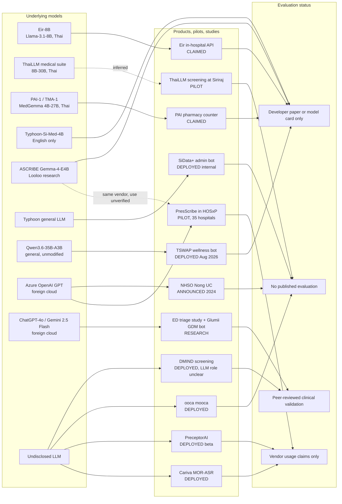

# Thai Medical LLMs Outrun Their Own Evidence

As of October 2026, Thailand has **four families of Thai-built medical LLMs**: Eir-8B (2024), the national ThaiLLM consortium's medical suite (Jan–Aug 2026), I C Develop's MedGemma-based PAI-1 and TMA-1 (Jul 2026), and SCB 10X × Siriraj's Typhoon-Si-Med-Thinking-4B, which is English-only. A few smaller research models sit alongside them (ASCRIBE, AppHerb, CU-ICU), and CARIVA's closed PreceptorAI is a fifth, undisclosed one. **Every score for a Thai-specialised medical model is self-reported.** Most were measured on private in-house test sets or English benchmarks, often with another LLM acting as judge. No Thai medical model has been tested on the Thai licensing-exam mock or on the translated HealMed-Thai benchmark, the two places where independent scores for frontier models do exist. On the product side, the evidence points the other way. Clinical documentation scribes are the only LLM category with multi-hospital reach: Cariva MOR-ASR claims **465,000+ sessions across 30+ live or proof-of-concept (POC) hospitals**, and Looloo Health's PresScribe runs a **35-hospital pilot inside HOSxP on Azure OpenAI**. These products mostly run on undisclosed or foreign cloud models, not the Thai open-weight ones. No LLM product has a disclosed Thai FDA (อย.) Software as a Medical Device (SaMD) registration or published post-market surveillance. The only peer-reviewed clinical validations come from research systems (ChatGPT-4o ED triage, the Glumii gestational-diabetes bot) and from DMIND depression screening, whose LLM component is unclear. For a capstone, this leaves several research gaps that can be studied with open weights: independent Thai evaluation, triage and red-flag safety, scribe error audits, and medication safety.

## Four Thai-built model families exist, and each has a named weakness

The Thai model ecosystem converged in 2026 on small (4–30B) open-weight models fine-tuned from Qwen3/ThaiLLM or Google MedGemma. They are built for RAG over external knowledge bases rather than standalone recall ([ThaiLLM HF org](https://huggingface.co/ThaiLLM); [icdevelop HF](https://huggingface.co/icdevelop)). The dependence on retrieval is large and measurable. TMA-1 4B's knowledge score jumps from **45.0% without RAG to 83.5% with it**, and PAI-1 4B's drug lookup goes from **37.5% to 64.0%** ([TMA-1 4B](https://huggingface.co/icdevelop/tma1-medgemma-4b); [PAI-1 4B](https://huggingface.co/icdevelop/pai1-medgemma-4b)). Licensing is a hidden deployment risk. MedGemma derivatives inherit Google's Health AI Developer Foundations (HAI-DEF) terms, and the ThaiLLM-8B-MedApp card states that its parent repos "do not currently expose explicit license metadata" ([MedApp card](https://huggingface.co/ThaiLLM/ThaiLLM-8B-MedApp)).

| Model | Developer | Base / size | Status (Oct 2026) | Best evidence / score (all self-reported) | Specific gap |
|---|---|---|---|---|---|
| **Eir-8B / Eir-8B-Prob** | EIR Team (EIRTHAIMED) | Llama-3.1-8B, 8B, Llama 3.1 license | Open weights, Sep 2024 | English MedQA **64.5** / PubMedQA **79.0** / MedMCQA **58.6**, 9-task average 71.9 (Prob: 80.2). 18-task Thai clinical average **7.11 vs GPT-4o 6.38**, with GPT-4o as the judge ([card](https://huggingface.co/EIRTHAIMED/Llama-3.1-EIRAI-8B); [arXiv](https://arxiv.org/abs/2409.08523)) | The Thai suite is unreleased and judged by a competitor model. The "human evaluation" has no published protocol. The card says real-world deployment is "not recommended" |
| **ThaiLLM-8B-SFT-IQ / 30B-IQ** | ThaiLLM consortium | ThaiLLM-8B-SFT (Qwen3, 8B) / ThaiLLM-30B (MoE) | Open weights, Jan 2026 | 8B: BLEU **0.4363**, citation Jaccard **0.5485** ([8B](https://huggingface.co/ThaiLLM/ThaiLLM-8B-SFT-IQ)). The 30B results row is labelled with the 8B model's name ([30B](https://huggingface.co/ThaiLLM/ThaiLLM-30B-IQ)) | Only lexical overlap is measured. Abstention ("unknown") behaviour and hallucination rate are untested. The 30B score attribution is UNVERIFIED |
| **ThaiLLM-27B-Prescreen (+Preview)** | ThaiLLM consortium | RL LoRA on MedGemma-27B-text-it (Preview: QLoRA on ThaiLLM-27B) | Open, Apr 2026 | Disease F1 **0.735**, department 0.541, severity 0.571, severity accuracy 0.799 on 288 synthetic cases ([card](https://huggingface.co/ThaiLLM/ThaiLLM-27B-Prescreen)) | **"Observe at Home" F1 = 0 (n=36): it never recommends home care.** Data is fully synthetic, with no clinician comparison |
| **ThaiLLM-8B-ToolUse** | ThaiLLM consortium | Typhoon-S-ThaiLLM-8B, RL | Open, Apr 2026 | Accuracy **0.999**, macro-F1 0.993 across 8 medical-app tools ([card](https://huggingface.co/ThaiLLM/ThaiLLM-8B-ToolUse)) | Measures routing only. Conversational medical content and safety are not evaluated |
| **ThaiLLM-8B-MedApp v2** | ThaiLLM consortium | 0.70 × MedApp v1 + 0.30 × ToolUse merge, 8B | Open, Aug 2026 | med-IQ response **75.83%**, citations 67.82% (200 × 3, DeepSeek judge). Tool pass@1 **99.92%** (5,122) ([card](https://huggingface.co/ThaiLLM/ThaiLLM-8B-MedApp)) | The card itself says medical safety, refusal, privacy and production monitoring "require additional evaluation". Merging "can introduce behavior absent from either parent" |
| **PAI-1 (pharmacy)** | I C Develop | MedGemma 4B / 27B, HAI-DEF, gated | Gated weights, Jul 2026 | Lookup+RAG **64.0% (4B) / 64.5% (27B)**. Deliberation 48.3% / 38.3% (n=120) ([27B](https://huggingface.co/icdevelop/pai1-medgemma-27b)) | "DRAFT pending pharmacist and legal review". 534 AI-generated knowledge-base entries are unreviewed. The 27B model is no better than the 4B. Image input is not evaluated |
| **TMA-1 (consumer health)** | I C Develop | MedGemma 4B / 27B, HAI-DEF, gated | Gated draft, Jul 2026 | RAG knowledge 83.5% / 89.5–90.0%. Safety/referral **96.7% / 98.3%** ([4B](https://huggingface.co/icdevelop/tma1-medgemma-4b); [27B FP8](https://huggingface.co/icdevelop/tma1-medgemma-27b-fp8)) | **Drug–drug interaction ≤27%.** No physician review, images not evaluated, no real-user testing |
| **Typhoon-Si-Med-Thinking-4B** | SCB 10X + SiData+ Siriraj | Qwen3-4B, Apache-2.0 | Research preview, Sep 2025 / Jan 2026 | English ranked-list accuracy **94.73** (MRR 90.68) vs Gemini 2.5 Pro 68.46 ([Typhoon blog](https://opentyphoon.ai/blog/en/typhoon-si-med-thinking)) | "Never trained on Thai medical data". No safety, hallucination or Thai evaluation |
| **ASCRIBE Gemma-4-E4B** | Looloo Health, Kasetsart, Mahidol | Gemma-4-E4B (~4.5B effective) | Research, 1 Oct 2026 | On ThaiClinicBench (44 real encounters), matches Gemini 3.1 Pro on factual precision and beats it on completeness ([arXiv](https://arxiv.org/abs/2610.01234)) | Small single-site sample with an LLM-judge metric. Use inside PresScribe is UNVERIFIED |
| **AppHerb-TrP / HRG** | Khon Kaen University | Gemma-2 9B LoRA, non-commercial | Research, Jul 2025 | Task F1 **24.00% / 24.84%** ([AI journal](https://doi.org/10.3390/ai6080170)) | Text similarity is not herbal safety. Authors require clinical validation |
| **CU-ICU** | T. Panboonyuen | FLAN-T5 | Preprint, Jul 2025 | Up to +15% sepsis-detection accuracy over standard fine-tuning ([arXiv](https://arxiv.org/abs/2507.13655)) | No Thai-language data or Thai validation shown. Chula affiliation UNVERIFIED |
| **PreceptorAI medical LLM** | CARIVA (BDMS-backed) | Closed, base undisclosed | Beta since Apr 2023 | Vendor claims a "98th percentile" equivalent on an NL test ([CARIVA deck](https://forumhai.com/api/api/publisher/download/2989)) | Test form, raw accuracy and protocol are undisclosed. No model card exists |

Several things do not exist. There is no official medical variant of NECTEC Pathumma, OpenThaiGPT, iApp/Chinda or KBTG. Repos named "typhoon-med" and "thai-med" are individual fine-tunes without evaluations ([HF search](https://huggingface.co/models?search=thai%20med)). Gemini's note adds that Pathumma 3.0.0 pre-training includes ~42.9M medical tokens. That makes it a general model with medical data, not a medical model, and no medical scores are published for it ([HF card](https://huggingface.co/nectec/pathumma-thaillm-8b-think-3.0.0)).

## Scribes reach dozens of hospitals while patient-facing bots stay unproven

Products separate cleanly by how close they get to clinical decisions. Documentation and administrative tools have scaled because they sit behind a clinician's sign-off. Tools that face patients give the least technical disclosure. In the tables, "LLM" means the model the vendor discloses.

**DEPLOYED (live use stated by a source)**

| Product | Organisation | LLM | Scale / evidence | Specific gap |
|---|---|---|---|---|
| **MOR-ASR / CARIVA Space** (AI scribe) | CARIVA | Undisclosed | **465,000+ sessions; 30+ hospitals live or POC** (20+ private, 2 public, 1 medical school); "up to 50%" less documentation ([cariva.co.th](https://cariva.co.th/en)) | Live vs POC split, word error rate and SOAP omission/hallucination rates are unpublished. All figures are vendor-only |
| **PreceptorAI** (clinician copilot, LINE) | CARIVA / BDMS | Undisclosed | Beta: **12,000 medical users, 400,000 uses** ([deck](https://forumhai.com/api/api/publisher/download/2989)); operating since Apr 2023 ([Khaosod English](https://www.khaosodenglish.com/sustain/2024/04/03/bdms-invests-in-cariva-for-ai-driven-personalized-diagnosis/)) | No reporting period, no active-user count, no accuracy or override-rate study |
| **SiData+ Admin Chatbot** | Siriraj + SCB 10X | Typhoon + RAG | Internal staff tool covering data governance, with data kept in Thailand ([OpenTyphoon](https://opentyphoon.ai/blog/th/use-case-siriraj-sidataplus-admin-chatbot)) | Non-clinical. No usage numbers or retrieval accuracy published |
| **TSWAP Wellness Chatbot** | Digital Touch Point + iApp | Qwen3.6-35B-A3B, self-hosted | Recall@5 **0.88** (n=50); **91.1%** test–retest pass over 259 production cases ([arXiv](https://arxiv.org/abs/2608.22917)) | Without its safety prompt, the backend model produced "a full drug-dosing schedule". 4-bit AWQ quantization corrupts Thai tone marks. No herbal-safety expert grading |
| **ooca "mooca"** (mental-health companion) | ooca / Telehealth Thailand | Undisclosed "AI providers" | Release notes describe cross-session memory and semantic safety filtering ([App Store](https://apps.apple.com/us/app/id1260476046)) | Crisis and self-harm escalation sensitivity is unmeasured. No outcome data |
| **DMIND** (depression screening) | Chula, Dept of Mental Health, NHSO | "NLP models and LLMs", base undisclosed | Cross-sectional study, n=388 vs HDRS-17: **sensitivity 87.30%, specificity 59.50%** ([Chula Med J](https://doi.org/10.56808/2673-060X.5495)) | The LLM's role is unclear. Low specificity means a false-positive referral burden. Usage of >300,000 screenings is UNVERIFIED |

**PILOT (trial, proof of concept or limited rollout)**

| Product | Organisation | LLM | Scale / evidence | Specific gap |
|---|---|---|---|---|
| **PresScribe** (scribe inside HOSxP) | Looloo Health + BMS | Azure OpenAI (model unnamed) | **35-hospital pilot from 1 Nov 2024**. 80% time saving is a projection ([Microsoft](https://news.microsoft.com/source/asia/2025/05/20/bangkok-medical-software-utilizes-presscribe-ai-by-looloo-health-to-enhance-healthcare-services-across-35-hospitals-in-thailand-en/)) | No 2025–26 site count, no measured error rates, and patient data goes to a foreign cloud model |
| **ThaiLLM medical screening model** | BDI / MDES / NECTEC at Siriraj | ThaiLLM (likely the Prescreen line, inferred) | Piloted "to help doctors and nurses screen patients" ([Bangkok Post](https://www.bangkokpost.com/business/general/3295694/launching-a-bid-for-ai-sovereignty)) | NECTEC blind-test results are unpublished. Inherits Prescreen's home-care blind spot if it is the same model |
| **Cariva hospital voice agent** | CARIVA, OpenAI × MHESI accelerator | Not stated | Goal: one live pilot call flow by Demo Day, Nov 2026 ([OpenAI](https://openai.com/index/supporting-next-generation-ai-startups-thailand/)) | Emergency-recognition accuracy is unmeasured |
| **Eidy** | Trillion Sure | "Multilingual Medical LLM", base undisclosed | 400+ doctors trialling (~early 2025) ([Bangkokbiznews](https://www.bangkokbiznews.com/health/well-being/1161010)) | Anecdotal accuracy only. Current status unknown |
| **AN AN Bot** | Agnos, Vimut, Neurological Institute | LLM not confirmed | Testing announced Oct 2024 ([The Coverage](https://www.thecoverage.info/news/content/7640)) | Launch is unconfirmed. "AI chatbot" does not establish that an LLM is used |
| **MUSYA AI** (policy drafting) | ThaiHealth + Ubon Ratchathani U. | Undisclosed | 110 officials; usability 97/100 ([MGR Online](https://mgronline.com/politics/detail/9690000100264)) | Non-clinical. Evaluation method not described |
| **CXRReportGen** | Ramathibodi | Phi-3-Mini + BiomedCLIP | Report-drafting pilot ([Microsoft](https://news.microsoft.com/source/asia/2026/04/17/with-ramaai-thailands-radiologists-get-ai-assistance-to-screen-x-rays/)) | No report-accuracy figures |

**ANNOUNCED or CLAIMED-ONLY**

| Product | Organisation | LLM | Status / evidence | Specific gap |
|---|---|---|---|---|
| **NHSO "AI for a Healthier Thailand" / Nong UC** | NHSO + Microsoft + FRONTIS | Azure OpenAI | Built and announced May 2024; "66 million" is the potential population served ([Microsoft](https://news.microsoft.com/source/asia/2024/05/01/microsoft-announces-significant-commitments-to-enable-a-cloud-and-ai-powered-future-for-thailand/)) | Production rollout is UNVERIFIED. No accuracy data on benefit rules |
| **NHSO 1330 Smart Contact Center** | NHSO | — | Strategy only ([Thansettakij](https://www.thansettakij.com/health-wellness/668423)) | Not launched |
| **MOPH–True AI-5G หมอพร้อม Super App** | MOPH + True | — | MOU, 2026 ([Kaohoon](https://www.kaohoon.com/pr/820211)) | No LLM disclosed. The current หมอพร้อม (>30M users) has no LLM ([Hfocus](https://www.hfocus.org/content/2026/05/38121)) |
| **PAI pharmacy-counter use** | I C Develop | PAI-1 (MedGemma) | Vendor says "In production at the pharmacy counter" and names no customer ([README](https://icdevelop-readme.static.hf.space/README.md)) | Contradicts the model's own DRAFT status |
| **Eir in-hospital deployment** | EIR Team | Eir-8B | Paper says it is "deployed within the hospital's internal network" without naming the hospital ([arXiv](https://arxiv.org/abs/2409.08523)) | The model card advises against deployment |

The big telemedicine apps (MorDee, Doctor Raksa, BeDee, Doctor A to Z) have no confirmed LLM feature. Thailand's most-deployed clinical AI, SiAiR at 610 hospitals and RAMAAI, is imaging AI rather than an LLM ([Thansettakij](https://www.thansettakij.com/health-wellness/666754)).

## Thai-built models barely reach deployed products

The diagram below traces each model to its product and each product to the strongest evidence that exists for it. Two patterns stand out. The Thai open-weight models connect to products only through pilots or unverified vendor claims. And the only arrows into "peer-reviewed clinical validation" come from research systems on foreign cloud models and from DMIND, whose underlying model is not disclosed.

The evidence gap is structural. The products with the most technical disclosure (Eir, I C Develop, Typhoon-Si) are research or open-weight releases with no verified deployment. The products with real scale (Cariva, PresScribe) disclose almost nothing about their models. A 2024 Mahidol preprint names compute cost, privacy and Thai's low-resource status as adoption barriers ([medRxiv](https://medrxiv.org/content/10.1101/2024.06.10.24308731.full.pdf)). Those barriers fit this split: hospitals in production rent foreign cloud models, while sovereign Thai models wait in pilots. Regulation does not force convergence either. Software with a medical purpose can fall under the Medical Device Act's purpose test, but no LLM-specific อย. guidance was found. The PDPC's AI guideline v1.0 (7 Oct 2026) is non-binding. It advises on-prem deployment or no-training agreements when sensitive data is involved, and it treats entering patient data into generative AI as a possible disclosure to the provider ([TRAINIAC summary](https://www.trainiac.ai/blog/ai-in-healthcare-thailand)). Positioning scribes and staff tools as non-medical-purpose software, and therefore outside SaMD rules, is a plausible strategy. No vendor states this explicitly.

## Frontier models score 89–97% on Thai exam items that no Thai medical model has taken

Thailand has no public, native-Thai medical benchmark comparable to KorMedMCQA or KokushiMD. The **ThaiNLE Step 1 mock (304 MCQs, 10.2% with images) is written in English**. Its availability is contested: the preprint calls it private, while the journal version points to a Harvard Dataverse deposit with "restricted dataset access". On this mock, GPT-4o scored **88.9%** against a human pass mark of about **52.3%** ([JEEHP 2025](https://www.jeehp.org/journal/view.php?number=562)). HealMed provides expert-reviewed Thai *translations* of Western items. There, GPT-5.4 reaches **97.33% on MedQA-TH** and MedGemma-27B reaches 70.67%. That is roughly 75 items per task, so confidence intervals are wide, and no Thai-specialised model was tested ([arXiv HealMed](https://arxiv.org/html/2608.19981)). Thai MCQ knowledge tests are therefore close to saturation for frontier models, and they say nothing about safety or workflow. ThaiSafetyBench (1,954 prompts) touches health only through its mental-health, misinformation and COVID categories ([arXiv](https://arxiv.org/html/2603.04992v2)). ThaiClinicBench, with 44 real encounters, is the first de-identified Thai clinical summarisation benchmark ([arXiv ASCRIBE](https://arxiv.org/abs/2610.01234)).

Independent clinical evidence in Thai is small and concerns one system at a time. The strongest study used voice-enabled **ChatGPT-4o for ESI triage in 387 consecutive ED patients at Warin Chamrap Hospital**. Its agreement with a physician panel was weighted kappa **0.915, versus 0.607 for triage nurses**, and its mis-triage rate was 5.9% versus 28.4%. This was a single-centre research study, not a deployed product ([Thai J Emerg Med](https://he02.tci-thaijo.org/index.php/TJEM/article/view/277102)). Glumii, a Gemini 2.5 Flash RAG bot for gestational diabetes, scored **84%** question-level accuracy across 225 responses rated by 10 professionals. Accuracy on general antenatal care fell to 68–72%, and raters observed "medical hallucinations" ([IEEE Access](https://ieeexplore.ieee.org/abstract/document/11679108/)). The only Thai medication-instruction evaluation is a pilot in which **5 pharmacists rated ChatGPT-3.5 on 3 questions** ([PMC](https://pmc.ncbi.nlm.nih.gov/articles/PMC11418248/)).

## Cross-model agreement

**All three research streams agreed** (Claude notes, Codex GPT-6.1-Sol, Gemini 4 Argon, each with URLs). They agreed on the core model inventory: Eir-8B, the ThaiLLM IQ/MedApp suite, I C Develop's PAI-1, Typhoon-Si-Med-4B and PreceptorAI. They agreed that Typhoon-Si-Med is evaluated in English (94.73 list accuracy vs Gemini 2.5 Pro 68.46). They agreed on the frontier-model ThaiNLE scores (GPT-4o 88.9%, Claude 3.5 Sonnet 80.1%, Gemini 1.5 Pro 72.8%). They agreed that Cariva's MOR-ASR metrics (465k sessions, 50%) are vendor-only, and that no LLM product has a verified Thai FDA SaMD registration. Claude and Codex independently found the PresScribe Azure OpenAI 35-hospital rollout, the Prescreen "Observe at Home" F1 of 0, the TMA-1 DDI ceiling of ≤27%, and the 30B-IQ label error. Several items appeared in only one note, and I checked their URLs this session. Codex-only items were confirmed live: ASCRIBE, TSWAP, AppHerb, CU-ICU, the NHSO Azure OpenAI announcement, and the PreceptorAI deck stating "12,000 medical users with 400,000 times". The mooca listing (Codex and Gemini) was confirmed live. The DMIND DOI (Gemini-only) resolves to the study with the stated figures.

**Material divergences:**

| Claim | Claude notes | Codex | Gemini | Resolution |
|---|---|---|---|---|
| Eir MedQA / PubMedQA | 64.5 / 79.0 | 64.5 / 79.0 | **79.0 / 64.5**, MMLU subsets reshuffled | Gemini swapped values; the card supports Claude and Codex |
| MedApp scores | v2 response 75.83%, tool pass@1 99.92% | Same | **68.33 / 68.40 / 98.63% / 89.64%** | Gemini's numbers do not appear on the current card (checked) → UNVERIFIED, possibly a superseded v1 card |
| MedApp / IQ license | No license metadata | Absent | **Apache-2.0** | Card confirms no explicit license; Gemini is incorrect |
| PAI-1 scores | Full tables | Full tables | "No quantitative scores published" | Gemini is incorrect; the tables are on the cards |
| PreceptorAI usage | Not found | 12,000 users / 400,000 uses (PDF) | >10,000 / >300,000 (Beartai and Techsauce homepages) | Codex's figure is verified; Gemini's is UNVERIFIED |
| PreceptorAI architecture | Undisclosed | UNVERIFIED | Llama variants plus frontier APIs; Code SICAR / CliniTHink papers | UNVERIFIED. The site lists EMNLP/CVPR/NeurIPS/ACL output generally ([preceptorai.tech](https://preceptorai.tech/)) |
| PresScribe status | "Deployed", 35-hospital pilot | Pilot | — | Source says pilot; classed PILOT here |
| NHSO LLM | No chatbot on @nhso; 1330 plan only | Nong UC on Azure OpenAI (May 2024) | "Mady" RAG bot and Doctor at Home on @nhso | Codex is verified. Gemini's Mady claim rests on homepage URLs → UNVERIFIED |
| ooca AI | No AI chatbot found | mooca exists | mooca exists | Two sources plus a verified listing; Claude's search missed it |
| Deployment trend | Foreign cloud LLMs dominate production | Same | "Pivot to small on-prem models due to PDPA" | Gemini's trend describes model releases, not deployments; unsupported for products |
| Scribe regulatory status | Non-SaMD positioning is an inference | UNVERIFIED | Stated as "exempt" | No source confirms an exemption |
| Typhoon-Si public launch | ~Jan 2026 | 9 Jan 2026 (blog) | 23 Jan 2026 (Techsauce homepage) | Minor; 9 Jan is sourced |

**UNVERIFIED (Gemini-only, no working URL):** the Chula–KBTG LLM "Virtual Patient" (cited URL returns 404); the DTAM Panthai AI Doctor (domain did not resolve); Agnos's "59% wait-time reduction" and ">90% triage accuracy"; The Medicative "Mady"; LLM symptom checkers in MorDee, BeDee and Well by Samitivej; Chinda LLM hospital RAG; NECTEC SQUAT/TCELS SaMD enforcement claims; and DMIND's >300,000-screening figure.

## Conclusion

Thailand's problem is not missing models. It is missing evaluation between the model and the bedside. The Thai open-weight models with the most transparent model cards (MedApp, Prescreen, TMA-1) are exactly the ones that reach only pilots. Meanwhile, the products that clinicians actually use run on models nobody outside the vendor can inspect. That turns the usual research question around. The most valuable work is not training another Thai medical model. It is building the shared, Thai-native, safety-weighted test bed that would let any of these models or products be compared. The open-weight Thai models make that feasible for a single student today.

Two warning signs deserve attention before any wider rollout. One is a triage model that never recommends home care, which would flood emergency departments. The other is a backend model that produced a full dosing schedule once its safety prompt was removed. Both show that the failures that matter clinically are invisible on MCQ leaderboards. They appear only in triage-class breakdowns and adversarial probes, which almost no Thai evaluation runs.

## Gaps across the landscape

| # | Research gap | Evidence the gap is open | Feasible capstone shape | Open resources to start from |
|---|---|---|---|---|
| 1 | **Independent head-to-head evaluation of Thai medical models** | Every Thai medical-model score is self-reported. None appears on HealMed-TH or ThaiNLE ([HealMed](https://arxiv.org/html/2608.19981)) | Run Eir-8B, MedApp v2, TMA-1, Typhoon-Si and a frontier baseline on HealMed-TH plus a small clinician-graded Thai set | Open or gated HF weights; HealMed Thai slice |
| 2 | **Thai triage and red-flag safety benchmark** | Prescreen "Observe at Home" F1 = 0; no Thai triage dataset exists ([card](https://huggingface.co/ThaiLLM/ThaiLLM-27B-Prescreen)) | 200–300 Thai vignettes labelled for ESI/disposition and 1669 referral; measure under- and over-triage | ThaiLLM/med-prescreen; Warin Chamrap protocol ([ThaiJo](https://he02.tci-thaijo.org/index.php/TJEM/article/view/277102)) |
| 3 | **Thai-English scribe error audit** | MOR-ASR and PresScribe publish no omission or hallucination rates; ThaiClinicBench has only 44 encounters ([ASCRIBE](https://arxiv.org/abs/2610.01234)) | Clinician-annotated taxonomy of SOAP errors (omission, fabrication, negation) on simulated consultations | ThaiClinicBench, ASCRIBE code (MIT) |
| 4 | **Medication and pharmacy safety** | TMA-1 DDI ≤27%; the only external study is 3 questions with 5 pharmacists ([PMC](https://pmc.ncbi.nlm.nih.gov/articles/PMC11418248/)) | Thai DDI, pregnancy and paediatric dosing test set built on NLEM and Thai brand names | TMT drug registry; PAI-1/TMA-1 weights |
| 5 | **Thai-native clinical knowledge** | Cross-model Thai scores come from translated Western items ([HealMed](https://arxiv.org/html/2608.19981)) | Vignettes on melioidosis, opisthorchiasis, dengue, scrub typhus and thalassemia aligned with MOPH guidelines | Thai CPGs; WangchanThaiInstruct medical split |
| 6 | **RAG faithfulness and abstention** | ThaiLLM-IQ reports only BLEU and citation Jaccard; the "unknown" behaviour is untested ([card](https://huggingface.co/ThaiLLM/ThaiLLM-8B-SFT-IQ)) | Claim-level faithfulness plus unanswerable-question abstention study | ThaiLLM/med-iq, med-articles |
| 7 | **Mental-health crisis escalation** | mooca has no measured crisis sensitivity; DMIND specificity is 59.5% ([Chula Med J](https://doi.org/10.56808/2673-060X.5495)) | Simulated Thai at-risk dialogues scored for 1323 referral and harmful-reply rate | ThaiSafetyBench mental-health category |
| 8 | **Quantization and on-prem deployment trade-offs** | AWQ corrupts Thai tone marks (TSWAP); PDPC advises on-prem processing ([TSWAP](https://arxiv.org/abs/2608.22917)) | Benchmark FP16, FP8 and 4-bit Thai medical models on accuracy, Thai text integrity and GPU cost | GGUF/FP8 builds on HF |
| 9 | **Model-merge and tool-use safety** | The MedApp card warns merging "can introduce behavior absent from either parent" ([card](https://huggingface.co/ThaiLLM/ThaiLLM-8B-MedApp)) | Red-team v1, v2 and ToolUse for unsafe tool calls and prompt injection through RAG | Open MedApp v1/v2 tags |
| 10 | **Dialect, register and health literacy** | No Thai medical model is evaluated on Isan, Northern or Southern Thai, or on readability | Paired standard/dialect patient queries; readability and understanding test with lay users | Community dialect corpora |
| 11 | **Post-market surveillance framework** | No deployed Thai LLM product publishes incidents, override rates or audits | Design and pilot a PDPA-compliant monitoring schema with one hospital scribe or chatbot | PDPC AI guideline v1.0; MOPH WHA79 governance aims ([Hfocus](https://www.hfocus.org/content/2026/05/38121)) |
| 12 | **Thai traditional-medicine safety** | AppHerb F1 is ~24%; TSWAP has no expert herbal-safety grading ([AppHerb](https://doi.org/10.3390/ai6080170)) | Expert-graded herb–drug interaction and scope-refusal benchmark | AppHerb adapters; TSWAP retrieval benchmark |
