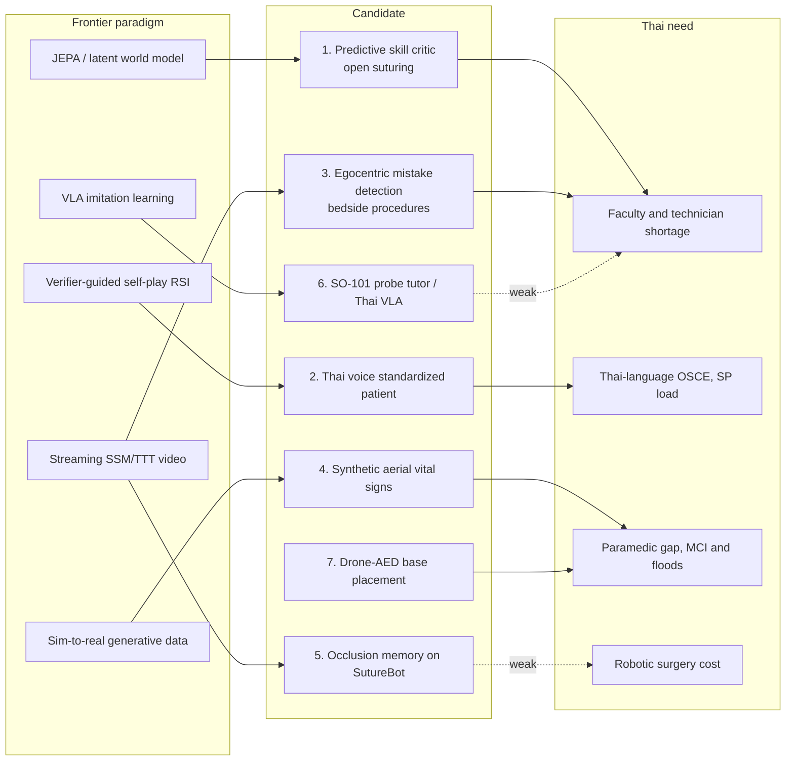

# Teach Machines to Judge Trainee Hands First

**Bottom line:** within physical AI, robotics, drones and XR, the best capstone for one RTX 4090 Laptop that also helps Thailand is **AI that perceives, scores and coaches human procedural skill**, not a robot or drone that acts. Robot autonomy has moved fast, but it runs on hardware this project cannot reach. SRT-H completed the clipping-and-cutting phase on **8 of 8 ex vivo gallbladders**, but the best fully autonomous suturing result is still **3 of 10**, and those policies were trained on **8×A100** GPUs with a dVRK robot. Fine-tuning π0 with LoRA alone needs **more than 22.5 GB** of VRAM. Thailand's medical drones are logistics pilots run by the Ministry of Public Health (MOPH) and True under new Civil Aviation Authority of Thailand (CAAT) rules, which leaves a student little to fly. The skill-assessment frontier is different: it is open, laptop-sized and relevant to Thailand. Video models reach a concordance (CCC) of **0.78–0.81 in-domain but only 0.06–0.20 across datasets**. The main review of LLM virtual patients **excluded every non-English study**. In Thailand, **93.3% of simulation administrators report a technician shortage**, and the national licensing exam ends in a **Thai-language OSCE**. The top-ranked direction is a **predictive, JEPA-style "distance to expert dynamics" skill model**: train it on public open-suturing video, then validate it on Chulalongkorn trainees at CHAMPS. A close second is a **Thai voice standardized patient trained by verifier-guided self-play**. That option carries the student's current audit-first RSI plan into medical education. Drones and low-cost robot arms rank lower: they are possible, but either their Thai impact or their frontier depth is weaker. One caveat applies throughout. Many "nobody has done this in Thailand" claims rest on English-language searches. Thai journals (ThaiJO) were not searched systematically, so every direction below includes a month-1 novelty and falsification check.

## Surgical robots reached 8-of-8 gallbladders on hardware this laptop cannot touch

From 2024 to 2026, medical robot learning went from subtasks on phantoms to step-level autonomy on real tissue. **SRT-H** (Science Robotics, July 2025) used a language-level planner that issues corrective instructions to a low-level trajectory policy. It reached **100% success on 8 unseen ex vivo porcine gallbladders** during clipping and cutting, with no human intervention. That is one step of an operation, done ex vivo, not a whole operation in a live patient ([arXiv 2505.10251](https://arxiv.org/abs/2505.10251)). **SutureBot** (NeurIPS 2025 Datasets & Benchmarks) released **1,890 demonstrations** and showed that end-to-end suturing remains unsolved. **ACT reached 3/10 end-to-end. π0, GR00T N1 and OpenVLA-OFT all scored 0/10**, and OpenVLA-OFT failed even individual subtasks. Training used 8×A100 80 GB, and the authors list no memory for the needle while it is occluded, no clinical metrics, and drops in performance under lighting changes ([arXiv 2510.20965](https://arxiv.org/html/2510.20965v1)). In 2026 the open data layer arrived. **Open-H-Embodiment** comes from more than 50 institutions under CC BY 4.0 in LeRobot format, alongside GR00T-H, billed as the first open medical VLA. GR00T-H reached **25%** end-to-end on structured suturing, where every other model scored 0% ([arXiv 2604.21017](https://arxiv.org/abs/2604.21017)). **ImitateCholec** adds more than 18,000 demonstrations from 34 ex vivo cholecystectomies ([PMC12891575](https://www.ncbi.nlm.nih.gov/pmc/articles/PMC12891575/)).

The more important shift for a laptop-bound student is that **world models are becoming the evaluation layer**. Cosmos-Surg-dVRK pairs a fine-tuned Cosmos world model with a V-JEPA 2 classifier to score policies without a real robot, and its rollouts correlate strongly with real dVRK outcomes ([arXiv 2510.16240](https://arxiv.org/html/2510.16240v2)). Cosmos-H-Dreams distils this into a real-time student model; NVIDIA claims about 160 FPS on one RTX PRO 6000, which is unverified ([HF blog](https://huggingface.co/blog/nvidia/cosmos-h-dreams)). The models are still weak on surgical meaning. In expert ratings of Veo-3 surgical video, the clips looked visually plausible but failed on instrument operation and surgical intent, a "plausibility gap" ([arXiv 2511.01775](https://arxiv.org/html/2511.01775v1)). A 2026 survey says explicit state-transition modelling has "only preliminary demonstrations" ([arXiv 2608.26214](https://arxiv.org/pdf/2608.26214)). Synthetic surgical video has so far been used for **recognition and robot policy** (SurgWorld, SAW), **not for assessing human skill** ([arXiv 2512.23162](https://arxiv.org/pdf/2512.23162v1); [arXiv 2603.13024](https://arxiv.org/abs/2603.13024)). That missing use is the opening the top-ranked direction below exploits.

Robots that help teach, rather than operate, have much thinner evidence. A humanoid-robot simulated patient was rated less realistic than a human actor, with very small differences in outcome ([OFFIS pilot](https://www.offis.de/offis/publikation/comparing-patient-simulation-with-a-humanoid-robot-or-a-human-actor-in-terms-of-training-success-and-acceptance-pilot-questionnaire-study.html)). The most mature learning-based clinical robot is autonomous ultrasound. **UltraBot** trained on **247,000 expert demonstration samples** and reports more than 90% success on carotid scans ([Nature Communications via RePEc](https://ideas.repec.org/a/nat/natcom/v16y2025i1d10.1038_s41467-025-62865-w.html)). Those same logged variables (probe pose, contact force, image quality) are what trainee assessment needs, yet no source used them for education.

What fits on the laptop decides what is realistic. The table combines official READMEs with second-hand figures. Rows marked unverified need a measurement in week 1.

| Model / tool | Fits a 16 GB RTX 4090 Laptop? | Source and confidence |
|---|---|---|
| ACT (tens of millions of params) | Train: yes | Best on SutureBot subtasks ([arXiv 2510.20965](https://arxiv.org/html/2510.20965v1)); memory figure not published |
| SmolVLA-450M | Fine-tune: yes, about 10–16 GB at batch 8 (second-hand) | 78.3% on a real SO-100 vs π0 61.7% ([HF Papers](https://huggingface.co/papers/2506.01844)); VRAM from a [community guide](https://openelab.io/pl/blogs/learn/how-to-fine-tune-smolvla-on-so-101-with-lerobot) |
| π0 / π0.5 | Inference only (>8 GB); LoRA needs >22.5 GB | [openpi README](https://github.com/Physical-Intelligence/openpi) |
| GR00T N1.7-3B | Inference borderline (16 GB+); fine-tune needs 40 GB+ | [Isaac-GR00T README](https://github.com/NVIDIA/Isaac-GR00T) |
| Cosmos-H world models | Unverified; multi-billion-parameter, so unlikely without quantization | Notes only |
| V-JEPA 2 / VideoMAE feature extraction | Likely yes (ViT-L); unverified | No source measured it |
| 4-bit 7–8B Thai LLM | Fits, but 4-bit AWQ corrupted Thai tone marks in one deployment | [TSWAP arXiv 2608.22917](https://arxiv.org/abs/2608.22917) |

Thailand's robotics base is real, but it has no learning-based work. Siriraj claims **more than 3,000 da Vinci operations** ([Siriraj](https://www2.si.mahidol.ac.th/en/case/the-4th-gen-robotic-surgery-da-vinci)). In 2020, Chula Engineering deployed its "Ninja" telemedicine robots and "Pinto" delivery robots to King Chulalongkorn Memorial Hospital (KCMH) and other hospitals ([Bangkok Post](https://bangkokpost.com/thailand/general/1895105/ninja-robots-to-help-treat-infected)). In January 2026, KCMH and True Digital launched **"Physical AI" robots**: a radioactive-iodine treatment robot and a rehabilitation robot for TB patients ([Newswise/Chula](https://www.newswise.com/articles/king-chulalongkorn-memorial-hospital-launches-physical-ai-powered-medical-robots)). Assoc. Prof. Ronnapee Chaichaowarat's Intelligent Robotics Lab at ISE received **more than 19.73 M THB from PMU-C in FY2025** for exoskeleton, rehabilitation and laparoscopic-robot work ([Chula ISE](https://www2.ise.eng.chula.ac.th/events/assoc-prof-ronnapee-chaichaowarat-and-his-team-welcomed-executives-from-pmuc-to)). The searches found **no Thai paper on imitation learning, VLAs or AI skill assessment**. A Siriraj Medical Journal review already called robotic surgery controversial in less affluent countries because of cost ([Mahidol repository](https://repository.li.mahidol.ac.th/handle/123456789/46379)). Chasing surgical autonomy is therefore both out of reach on this hardware and a poor fit for Thailand.

## Thai drones fly medicines in pilots; the open AI problem is seeing casualties

Worldwide, only logistics runs at national scale. Zipline handles nearly all of Rwanda's pharmaceutical deliveries, dispatching a drone about every 50 seconds ([NPR, Aug 2026](https://www.npr.org/2026/08/04/g-s1-136906/drones-healthcare-trump-administration-rwanda)), and the US State Department has committed **up to $150M** to the company ([State Dept](https://www.state.gov/digital-press-briefing-on-zipline-drone-delivery-and-the-america-first-global-health-strategy)). The business is fragile: the pioneer Swoop Aero went into liquidation after a FY2023 loss of $9.3M on $6.6M revenue ([Startup Daily](https://www.startupdaily.net/topic/business/drone-delivery-startup-swoop-aero-lands-in-liquidation/)). AED drones are feasible, but no survival benefit has been shown. In Sweden's real-world study, drones reached **18 actual cardiac arrests**. Bystanders used the AED in 6, and **1 patient survived** ([Lancet Digital Health](https://www.thelancet.com/journals/landig/article/PIIS2589-7500(23)00217-0/fulltext)). In Denmark, only **33% of suspected arrests were eligible for take-off** ([Resuscitation 2025](https://www.resuscitationjournal.com/article/S0300-9572(25)00056-5/fulltext)).

Aerial triage is still at the research and competition stage. The finals of the DARPA Triage Challenge run **5–13 November 2026**, with no results yet, and DARPA does not say whether the data will be released ([DARPA](https://www.darpa.mil/research/challenges/darpa-triage-challenge/events)). The best published drone vital-sign study had **37 mostly healthy adults**. Respiratory rate was clearly its weakest measure, at **82.8–85.2% "accuracy"**, a metric the abstract does not define ([PubMed 41807583](https://pubmed.ncbi.nlm.nih.gov/41807583/)). RWTH's camera-based triage used **15 subjects** and is explicitly preliminary ([MDPI Drones](https://www.mdpi.com/2504-446x/8/10/589)). A 2026 system paper calls the field "largely fragmented" across localisation, life-sign detection and triage ([ATRACT](https://arxiv.org/html/2605.17123)). Aerial vision-language navigation is moving fast but is still weak. AerialVLN baselines reach **5.1% success vs 80.8% for humans**, and OpenFly falls from **33.2% on seen scenes to 10.7% on unseen ones** ([survey arXiv 2604.13654](https://arxiv.org/html/2604.13654v1)).

Thailand moved in 2026 from scattered demonstrations to **MOPH-led pilots**. The True "SkyBridge" platform launched in Nan in July 2026 with a 46 km disaster-response route (about 35 minutes vs more than 2 hours by road) ([True](https://www.true.th/blog/en/true-skybridge-2/)). In October 2026 it ran in Mae Chaem: NCD medicines arrived in **14 minutes instead of 64**, and a 100 km eVTOL round trip reached Mae Hong Son ([Hfocus](https://www.hfocus.org/content/2026/10/39748)). Island trials ran in Phang Nga, Krabi and Satun. Per the Nation, Thailand **has no commercial medical-drone service provider** ([Nation Thailand](https://www.nationthailand.com/health-wellness/40064407)). The academic evidence base is Thammasat's AED-drone trial: **88/90 successful BVLOS deliveries**, a median response of 7 min 39 s and a median landing error of 122 cm, flown on sunny days only and with no real patients ([PMC11865582](https://pmc.ncbi.nlm.nih.gov/articles/PMC11865582/)). No source linked drones to the 1669/NIEMS dispatch system, and no Chula, Siriraj or Ramathibodi drone-engineering programme surfaced.

Regulation rules out flight research for a student. CAAT's rules effective **17 May 2026** require training, electronic registration, an online plan for every flight, ≥1M THB insurance and a risk-assessed "Specific Category" for non-standard operations ([Khaosod English](https://www.khaosodenglish.com/news/2026/05/13/thailand-tightens-drone-rules-effective-17-may/)). BVLOS falls under the SORA-based PDRA-101 guidance, which excludes populated areas ([CAAT PDRA-101](https://uasportal.caat.or.th/docs/guidanceFlight/CAAT-GM-UAS-PDRA101_rev00_21-May-2025.pdf)). The research value for an AI student is therefore **perception in simulation plus a small ground-level real dataset**, not flight. Drones in EMS education have almost no recent evidence. The newest studies predate 2021, for example a UCF drone-assisted SALT simulation where trainees triaged correctly only **52.43%** of the time ([PMC7577607](https://www.ncbi.nlm.nih.gov/pmc/articles/PMC7577607/)). That gap is real, but it is a gap in education design, not frontier ML.

## XR moves procedures modestly, and the AI inside it is the open frontier

The pooled evidence favours XR for **spatial and procedural skills**, not declarative knowledge. A 2025 BMC Medical Education meta-analysis of AR/MR (29 publications) found higher skill scores (WMD 12.31) and lower failure rates, but **no significant knowledge gain** (WMD 2.92, CI −1.73 to 7.57). Knowledge improved only with a live teacher, heterogeneity reached I² = 95.8%, and the failure-rate result showed publication bias ([Zhang et al. 2025](https://link.springer.com/article/10.1186/s12909-025-08166-8)). CPR is a warning case. VR/AR CPR training did not differ from face-to-face training (SMD −0.05) ([BMC Med Educ 2024](https://bmcmededuc.biomedcentral.com/articles/10.1186/s12909-024-05720-8)), and in a network meta-analysis VR ranked **last for compression rate** (SUCRA 8.9%) ([BMC Emerg Med 2025](https://bmcemergmed.biomedcentral.com/articles/10.1186/s12873-025-01256-2)). Haptics matter, so a pure-VR CPR app is not a credible capstone.

The platform market has narrowed. HoloLens 2 is discontinued, with security servicing ending 31 December 2027 ([UploadVR](https://www.uploadvr.com/microsoft-discontinuing-hololens-2/)), which strands much of the 2018–2023 mixed-reality medical literature. **Meta Quest 3's Passthrough Camera API** now gives apps the forward cameras at up to **1280×960, 30 FPS, 40–60 ms latency**, and from SDK v76 such apps can ship on the Store ([Meta developers](https://developers.meta.com/horizon/documentation/android-apps/passthrough-camera-samples/)). Quest 3 has hand tracking but, per background knowledge not re-checked, no eye tracking. Gaze-based assessment would therefore need a pricier headset, while 26-joint hand kinematics are freely available. Industry money is moving to the AI layer. Oxford Medical Simulation raised £5M in March 2026 for "AI-driven scenarios, learning analytics" ([OMS](https://oxfordmedicalsimulation.com/oxford-medical-simulation-secures-5-million-growth-financing-from-salica-investments-to-accelerate-expansion-of-immersive-clinical-training/)).

**LLM virtual standardized patients** are the busiest AI-in-XR area, and the gap they leave is specific. The 2026 JMIR Medical Informatics systematic review covers 39 studies. Only **30% were controlled**, samples were usually 10–50 students, and the review **excluded non-English studies** while calling for multilingual, emotion-annotated open datasets. It proposes thresholds: top-1 accuracy ≥0.80, hallucination ≤0.05, SUS ≥80, κ/ICC ≥0.80 ([Li & Lutfi 2026](https://pmc.ncbi.nlm.nih.gov/articles/PMC12811743/)). The strongest controlled result (Luo et al., n=184) found an LLM digital patient beat real-patient teaching on history-taking scores, **78.13 vs 67.08**, in a non-immersive setting (same source). Embodied XR versions remain feasibility demos. CLiVR runs on Quest 3 with about 1.4 s latency but was tested with only 13 faculty ([arXiv 2510.19031](https://arxiv.org/html/2510.19031v1)). The research found **no Thai-language LLM or XR virtual patient**. The building blocks exist: Typhoon2-Audio is a Thai speech-in, speech-out model, but its speech output is licensed **CC-BY-NC** ([HF card](https://huggingface.co/scb10x/llama3.1-typhoon2-audio-8b-instruct)). One caution: an earlier research stream claimed a Chula–KBTG LLM "virtual patient", but its URL was dead, so this must be checked before claiming novelty.

**Egocentric procedural AI** is mature in computer vision and almost absent in medicine. HoloAssist-style online mistake detection with LLM-generated explanations already places in challenges on non-medical tasks ([arXiv 2506.06174](https://arxiv.org/abs/2506.06174)). Ego-Exo4D includes a "Health" scenario ([docs](https://docs.ego-exo4d-data.org/)), but **Health is not in its proficiency-estimation subset** ([arXiv 2605.03848](https://arxiv.org/pdf/2605.03848)). For CPR, GaussMedAct reaches **92.1% top-1 on CPREval-6k** (6,372 videos) in real time, but the dataset's availability is unstated ([arXiv 2511.10060](https://arxiv.org/abs/2511.10060)). Thai XR studies are small, single-site and mostly older: a Walailak VR intubation trial (n=45) ([PMC8616725](https://www.ncbi.nlm.nih.gov/pmc/articles/PMC8616725/)) and a 2025 Thammasat AR randomised trial with **n=24** ([PubMed 40996281](https://pubmed.ncbi.nlm.nih.gov/40996281/)). Chula's ER-VIPE VR team training claims a 38% cut in serious ER errors, but only in a government press release ([thailand.go.th](https://thailand.go.th/event-detail/--vr-simulation--38)).

## Skill models score 0.8 at home and 0.2 away

Automated skill assessment shows a clear, documented gap: models do not generalise across sites. The legacy benchmark, **JIGSAWS**, has only **103 videos** from 8 surgeons, and its labels look inconsistent; some experts receive low scores ([arXiv 2608.17519](https://arxiv.org/html/2608.17519v1)). The usable modern datasets come from cheap cameras. **AIxSuture** has 314 videos of 157 students suturing before and after a course, with OSATS labels, on Zenodo ([PubMed 38526613](https://pubmed.ncbi.nlm.nih.gov/38526613/); [Zenodo](https://zenodo.org/records/7940583)). **LASANA** has **1,270 stereo laparoscopic-trainer recordings** with multi-rater scores and error labels ([arXiv 2602.09927](https://arxiv.org/abs/2602.09927)). The MICCAI **Open Suturing Skills** challenge filmed with a static GoPro ([arXiv 2605.22200](https://arxiv.org/abs/2605.22200)). This capture set-up is cheap enough to reproduce at CHAMPS.

The cross-rubric transfer study supplies the key numbers. An X3D+LSTM model reaches **CCC 0.78–0.81 in-domain on LASANA**, and a Kinetics-only backbone already reaches 0.78. Transferred into JIGSAWS, it falls to **CCC 0.06–0.20** (arXiv 2608.17519, same source). Contrastive domain adaptation reaches only Spearman 0.41–0.46 (same source). The OSS challenge found that general spatiotemporal video models win, that fine-grained OSATS prediction is data-hungry, and that "more work is needed to move automated skill assessment toward clinical impact" ([arXiv 2605.22200](https://arxiv.org/abs/2605.22200)). JEPA-style encoders already work here. A cataract-surgery JEPA with an attentive probe on a frozen encoder handled skill assessment well ([MIDL 2025](https://mlanthology.org/midl/2025/shah2025midl-vision/)). VLMs remain unreliable at fine-grained temporal surgical reasoning ([SurgRec arXiv 2603.29966](https://arxiv.org/html/2603.29966v2); [Rau et al.](https://arxiv.org/html/2504.02799v1)). The strong SurgSkill-Bench AUROC of about 0.88 depends on evaluator comments, not video alone ([arXiv 2608.30872](https://arxiv.org/pdf/2608.30872)).

Two findings matter most for feedback. First, AI tutoring can work. In the McGill Virtual Operative Assistant randomised trial (JAMA Network Open 2022), automated metric-based feedback in a VR neurosurgery simulator was compared with remote expert instruction ([Stony Brook record](https://researchconnect.stonybrook.edu/en/publications/effect-of-artificial-intelligence-tutoring-vs-expert-instruction-/)). McGill reports that the AI group learned 2.6× faster and performed 36% better than the expert-instructed group, and also became safer but slower ([McGill](https://www.mcgill.ca/neuro/node/5357)). That evidence comes from a simulator with rich built-in telemetry, not from cameras. Second, in a JHU prospective study of explainable-AI feedback on medical students' suturing, there was **no difference from video coaching in closing performance gaps**, though cognitive load and confidence improved ([arXiv 2508.02593](https://arxiv.org/abs/2508.02593)). Generating feedback is therefore not enough; *what* the feedback says is the open research question. The most defensible current pipeline turns structured perception (instrument–action–target triplets) into LLM-written feedback ([arXiv 2511.15159](https://arxiv.org/html/2511.15159v1)). No randomised trial of LLM- or VLM-generated procedural feedback was found.

## Thailand's binding constraint is instructor time, not equipment

The Thai demand signal points at assessment and coaching. Thailand has **29 accredited medical schools**, which produced **3,170 new doctors in 2025**, including 1,012 through the rural CPIRD track. MOPH reports a shortage of about **14,000 doctors**, with **37,645 of 80,256 licensed doctors in Bangkok** ([Hfocus, Jul 2026](https://www.hfocus.org/content/2026/07/38586)). In a national survey, **48.1% of interns were burned out**, 81.2% worked more than 80 hours a week, and high depersonalisation was associated with clinically harmful errors (aOR 2.21) ([PMC12117941](https://pmc.ncbi.nlm.nih.gov/articles/PMC12117941/)). The national simulation survey (2019–20 data) is the most direct evidence. **40% of responding schools had no simulation centre, 93.3% of administrators reported a technician shortage, and 74.4% of instructors reported insufficient faculty**. Screen-based simulation reached only 16.3% of students, while part-task trainers (96.7%) and standardized patients (90.2%) dominated ([Boonmak et al.](https://pmc.ncbi.nlm.nih.gov/articles/PMC9019967/)). The data is old, but nothing newer exists.

Assessment raises the stakes. Licensure is a three-step exam. Frontier LLMs already clear the Step 1 mock (**GPT-4o 88.9% vs a human pass mark of about 52.3%**) ([JEEHP 2025](https://www.jeehp.org/journal/view.php?number=562)), so a multiple-choice tutor bot is no longer novel. Step 3 is reportedly an OSCE run almost entirely in Thai, according to a secondary guide not checked against the exam body (CMA) ([uni2study](https://www.uni2study.com/articles/thailand-medical-council-licensing-exam-abroad-graduates)). EMS is the sharpest gap. There are **1,790 paramedics against a target of 7,500**, a reliance on 111,605 volunteers, and **2,574 subdistricts lacking adequate response units** ([Khaosod English, Sep 2026](https://www.khaosodenglish.com/news/2026/09/13/thailand-emergency-medical-system-faces-major-gaps-as-2574-subdistricts-lack-units/)).

Chula has the pieces for a medicine-and-engineering project. **CHAMPS** merged the clinical-skills centre with the simulation and CPR centre. It trains medical students, residents, nurses, EMTs and the public, and runs the "SmartSim" self-practice and booking system, but lists no AI or XR initiatives ([CHAMPS](https://champs.md.chula.ac.th/)). The July 2026 **BRIDGE-AI Summit** at KCMH gave a full day to AI in medical teaching and assessment. Its Chula Engineering panellists were Natawut Nupairoj, Atiwong Suchato (AI/NLP) and Ronnapee Chaichaowarat (robotics), alongside Medicine's Nijasri Suwanwela and Jutamas Saoraya (emergency medicine and health professions education) ([BRIDGE-AI 2026](https://mdcuconference.com/event/sm/content/14/TH/home)). The Chula AI Center launched with NVIDIA in July 2026 ([Newswise](https://www.newswise.com/articles/chula-hosts-cu-nvaitc-symposium-2026)). The programme's official name is the MSc in Digital and AI Technologies in Health Systems. Its site describes it as a one-year joint programme of Medicine and computer engineering, and it lists no capstone rules, so confirm these with the office ([digihealth.md.chula.ac.th](https://digihealth.md.chula.ac.th/)). Research with student participants can request Exempt or Expedited review at the Faculty of Medicine IRB ([IRB form](https://irb.md.chula.ac.th/wp-content/uploads/2024/09/AF-06-01-Submission-form-for-Ethical-Review.docx)). The risks are coercion when teachers recruit their own students, and PDPA handling of trainee video; the latter was not researched. Budget one to two months for ethics approval.

## Seven candidate capstones, ranked for the council

The ranking weighs five things: depth of frontier ML, Thai impact, laptop feasibility, partner readiness, and confidence that the idea is novel. The diagram shows why the top two dominate. They are the only candidates that link a frontier paradigm the council already endorsed (JEPA, or verifier-based RSI) to a documented Thai bottleneck through data that already exists.

| Rank | Direction | Frontier hook | Thai impact | Key risk | Month-1 falsification test |
|---|---|---|---|---|---|
| **1** | **Predictive "distance-to-expert" skill critic.** Train a small action-conditioned latent predictor on frozen V-JEPA 2 features of expert open suturing. Use its prediction error as a skill score that needs no labels and transfers across sites, plus time-localised feedback cues. Validate on CHAMPS trainees filmed with a GoPro or phone | JEPA/world model used as an *evaluator*. Not shown in any source: SurgWorld and SAW use generation only for recognition or policy | High: multiplies scarce instructors, fits existing part-task trainers. Measurable as instructor-minutes per competent learner | A Kinetics-only backbone already gets CCC 0.78, so the predictive signal could add nothing. Rater noise caps every score | Weeks 1–2: precompute V-JEPA 2 features for AIxSuture and LASANA's suture subset, and log VRAM and throughput. Weeks 3–4: train the predictor on top-quartile videos only. **Kill or pivot if** held-out prediction error has absolute Spearman ρ < 0.3 with OSATS/GOALS, **or** it fails to beat a supervised head on AIxSuture→LASANA transfer. Also secure one surgeon to rate 30 videos |
| **2** | **Thai voice LLM standardized patient trained by dual-verifier self-play.** Verifier A is a rule-based case-fact checker (no invented findings, no volunteered diagnosis). Verifier B is clinician-rated information coverage. The research question is when "patient fidelity" optimisation turns into reward hacking, for example a patient that becomes uninformative. Quest 3 embodiment is optional | Carries the council's RSI and reward-hacking question into a domain where errors do not harm patients | High: Step 3 Thai OSCE, 90% SP reliance, and the English-only gap in the LLM-VP review | XR integration becomes an engineering sink. A Chula–KBTG virtual patient might already exist. Typhoon2-Audio speech output is non-commercial, and 4-bit quantization can corrupt Thai tone marks | Author 20 Thai OSCE cases with an EM or health-professions-education clinician. Run 3 open models in 4-bit as patients through 10 scripted interviews each. **Kill the RL part if** the best off-the-shelf model already meets ≤5% hallucination and ≥90% coverage. **Kill the verifier premise if** verifier A disagrees with the clinician on >20% of turns. Also check voice round-trip under 2 s and Thai tone-mark integrity |
| **3** | **Egocentric step and mistake detection for bedside procedures** (WHO hand rub, sterile gloving, CPR on a manikin) from Quest 3 passthrough or a head-mounted camera, with MR overlay feedback | Streaming video models. A natural home for the council's Mamba/TTT idea as an online procedure monitor | Medium-high: CHAMPS self-practice; infection-control and CPR courses run at scale | Data collection burden. The task is either trivially easy (a hand-pose heuristic suffices) or too hard for a 16 GB VLM | Record 40 clips from 8 volunteers with scripted errors. **Kill if** a MediaPipe-plus-rules baseline already reaches ≥90% step F1 (no ML contribution), **or** the best frozen-feature probe stays below 50% (too hard). Confirm the passthrough-to-laptop pipeline runs at ≥10 FPS |
| **4** | **Synthetic-to-real aerial vital signs and triage cues.** Render avatars with ground-truth pulse and breathing under altitude, smoke and vibration, then validate on a small real set filmed from the ground. Optional add-on: a drone-view MCI triage trainer | Sim-to-real generative data; physical AI | Medium: MOPH drone pilots, floods affecting about 3M people, the paramedic gap. But no Thai operator uses drones for triage today | Rendering a sub-pixel pulse realistically is the whole problem. Real recordings need IRB approval, and CAAT rules bar flight | Render 10 avatars; confirm the classical POS method recovers the rendered heart rate. Train on renders and test on a public real rPPG set degraded to aerial resolution. **Kill if** the synthetic-trained model is no better than untrained POS on real data |
| **5** | **Occlusion memory for surgical imitation policies.** Add SSM/TTT memory to ACT on SutureBot or ImitateCholec, evaluated offline | Highest pure-ML frontier depth | Low: no dVRK in Thailand is known, and robotic-surgery cost is contested locally | Closed-loop validation is impossible, and offline action error predicts real success poorly | Train ACT on needle pickup on the laptop. **Kill if** one run takes more than 24 h, **or** action error does not spike during labelled occlusion windows, which would leave memory nothing to fix |
| **6** | **SO-101 arm (about US$300) as an ultrasound-probe or instrument-handover tutor**, with a SmolVLA policy and Thai instructions | VLA fine-tuning that fits 16 GB | Low-medium: low clinical realism, though it links to the Ronnapee lab and KCMH Physical-AI work | Clinicians on the committee see a toy. Hardware time eats the schedule | Collect 50 demonstrations and fine-tune SmolVLA. **Kill if** success is below 30%, **or** CHAMPS faculty see no teaching use in a 15-minute demonstration |
| **7** | **Drone-AED base placement for Bangkok or Pattaya** (coverage optimisation building on the Thammasat and Thai Resuscitation Council work) | Weak; operations research | High policy relevance | Access to geolocated cardiac-arrest data | Request data from NIEMS and the Thai Resuscitation Council. **Kill if** no geolocated cardiac-arrest data arrives within 6 weeks |

**Direction 1** ranks first because its hypothesis is sharp and the existing literature does not answer it. Supervised skill heads learn one rubric's quirks and collapse across sites (CCC ≤0.20). A predictor trained only on expert dynamics never sees a rubric, so its error should transfer better. The second half, localising *where* a trainee departs from expert dynamics, targets the JHU null result: the feedback becomes time-stamped and specific, not generic. The same machinery covers the README's Rehab-JEPA fallback: replace suturing video with rehabilitation-exercise skeletons, and replace CHAMPS with KCMH Rehabilitation Medicine, which already runs a Physical-AI robot programme with True. The partner question then decides the domain without changing the method. The steelman against it: the in-domain CCC of 0.78 from generic features suggests skill signal is easy to extract. If transfer turns out to fail because of rater disagreement rather than representation, no encoder can fix it. The month-1 test is designed to detect exactly that.

**Direction 2** is the strongest option if the student wants to keep the audit-first RSI work. It moves the dual-verifier, reward-hacking question from a triage chatbot, where Thai Prescreen already never recommends home care ([ThaiLLM-27B-Prescreen card](https://huggingface.co/ThaiLLM/ThaiLLM-27B-Prescreen)), into simulated patients. There, the failure modes are measurable against the Li & Lutfi thresholds, and the ethics are lighter. It is weaker on "physical AI" unless the Quest 3 embodiment is kept, and that embodiment is the part most likely to swallow months. **Directions 3 and 4** are credible second-tier options. Direction 3 needs new data collection but owns an empty benchmark slot. Direction 4 has the most dramatic Thai story (floods, islands) and the weakest path to a Thai user. **Directions 5–7** each fail one of the student's two criteria. Direction 5 has frontier depth without Thai impact, Direction 7 has Thai impact without frontier depth, and Direction 6 is short on both. Two ideas should be dropped outright: a VR-only CPR trainer, because pooled evidence shows VR is no better than face-to-face training and worst on compression rate, and any multiple-choice tutor bot, because frontier LLMs already pass the Step 1 mock.

## Conclusion

The physical-AI field reached the same turning point as the Thai LLM landscape: the bottleneck moved from *acting* to *judging*. Surgical robotics now uses world models to evaluate policies because real trials are too expensive. Thai medical LLMs lack independent evaluators. Thai simulation centres lack the instructors who evaluate trainees. So the thesis can be framed as **critic quality** in either case, whether the critic is a rule-based verifier judging an LLM patient or a latent predictor judging a trainee's hands. That framing gives the committee's engineers a frontier method question (when does a learned or rule-based critic stay faithful under optimisation and under distribution shift?) and gives its clinicians a measurable Thai outcome (instructor-minutes per competent learner).

The month-1 tests matter more than the ranking. Each is cheap, uses public data or 20–40 local recordings, and can kill its own direction before an IRB submission is spent on it. Run the first two in parallel during month 1, because they share almost nothing except the laptop. The council should then debate the results rather than the pitches. The partner the student can actually recruit should break any tie: a surgeon or CHAMPS educator for Direction 1, and an EM or health-professions-education clinician for Direction 2.
